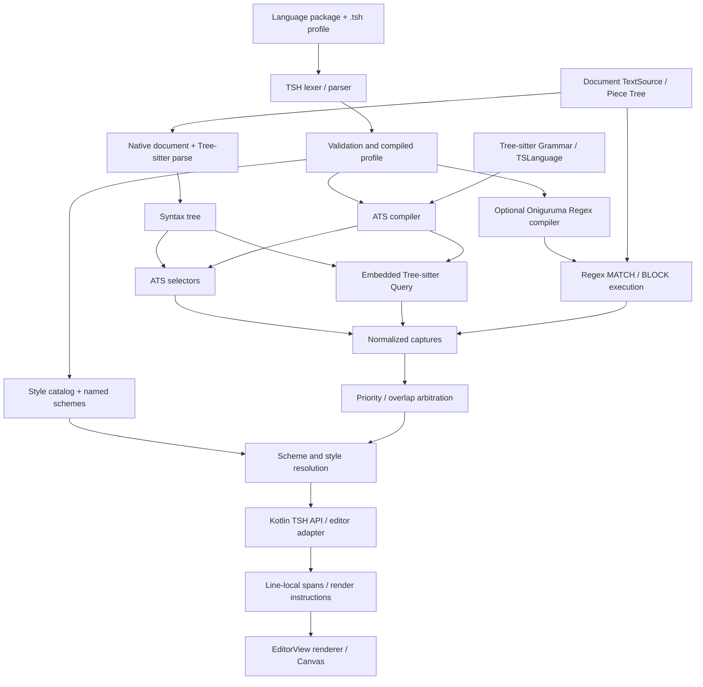
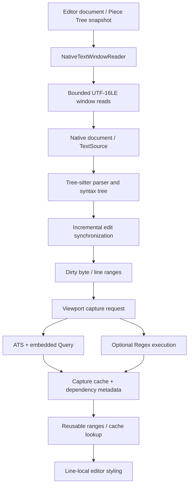

  
  <h1>Android Windbell Tree-sitter</h1>
  
<strong>Android Tree-sitter bindings, modular language grammars, and the Windbell TSH highlighting engine.</strong>

  
<a href="README_CN.md">简体中文</a> · <a href="docs/README.md">Documentation</a> · <a href="https://github.com/msmt2018/Android-Windbell-TreeSitter">GitHub</a> · <a href="https://tree-sitter.github.io/tree-sitter/">Tree-sitter</a> · <a href="https://jitpack.io/#msmt2018/Android-Windbell-TreeSitter">JitPack</a>

---

## Overview

**Android Windbell Tree-sitter** is an Android-focused Tree-sitter integration project. It combines a JNI binding layer, native Tree-sitter runtime, separately packaged language grammars, and **Windbell TSH (Tree-sitter Highlighting)**.

The repository is intended for Android code editors and developer tools that need syntax-tree parsing, structural language information, incremental document processing, and syntax highlighting.

### Main capabilities

- **Android JNI binding:** a single maintained binding module, <code>android-tree-sitter</code>, exposes the Tree-sitter API to Java and Kotlin.
- **Modular grammars:** language parsers are built as independent Android native-library modules. Applications can include only the grammars they need.
- **Windbell TSH:** a <code>.tsh</code> configuration engine combining Tree-sitter ATS selectors / native Tree-sitter queries with an optional, independent Oniguruma Regex rule path.
- **Semantic styles and themes:** <code>.tsh</code> files can describe language metadata, editor behavior, style catalogs, light/dark palettes, and highlighting rules.
- **Large-document infrastructure:** native text-source adapters include bounded window access, mapped/file-backed sources, and Piece Tree support. Incremental parsing and viewport-oriented capture APIs are available for editor integration.
- **Android rendering integration:** editor-side adapters turn TSH captures and resolved styles into Android text spans.

The TSH highlighting model is deliberately limited to **Tree-sitter ATS / Tree-sitter Query plus optional Regex**. This project does not use a Monarch pipeline or generated <code>.scm</code> highlighting pipeline.

> Large-file support is an architectural capability, not a universal performance guarantee. Actual parsing, capture, and final on-screen rendering performance depends on the grammar, document structure, device memory, and editor integration. Use the included tests and device measurements when evaluating a target workload.

## Windbell TSH — Tree-sitter Highlighting Engine

**Windbell TSH** is the repository's declarative syntax-highlighting and language-presentation engine. It is designed for Android code editors: a language package supplies its Tree-sitter grammar, a `.tsh` profile declares how that language should be recognized and styled, the native runtime produces source-ranged captures, and the editor adapter turns the resolved styles into actual line-rendering instructions.

TSH is not a hard-coded collection of language colors. The `.tsh` document is the source of truth for language metadata, semantic styles, color schemes, ATS selectors, embedded Tree-sitter queries, optional Regex rules, and editor-facing metadata. The native runtime is language- and theme-neutral.

### Design goals and defining characteristics

- **Grammar-aware highlighting:** use the real Tree-sitter syntax tree rather than relying on keyword lists alone. Rules can distinguish declarations, references, fields, nested syntax, comments, literals, and other grammar-defined structures.
- **Two matching backends, one result model:** ATS / Tree-sitter Query is the structural path; optional Oniguruma Regex is an independent text-pattern path. Their captures are normalized into a common range/style model before arbitration. Regex is not mixed into the Tree-sitter query engine.
- **Configuration-first styling:** semantic style names, palettes, typography flags, and UI theme tokens come from the profile. C++ does not assign language-specific colors or infer meaning from numeric style IDs.
- **Embedded queries:** Tree-sitter query source is stored in the `.tsh` profile and compiled against the selected `TSLanguage`. No generated or external `.scm` highlighting file is required.
- **Explicit precedence:** rules can declare priority and overlap behavior. Declaration order provides a stable tie-breaker; nested and non-conflicting intervals are retained rather than being discarded by arbitrary last-write-wins behavior.
- **Theme switching without reparsing:** named schemes and light/dark appearance are presentation data. Changing the selected scheme or appearance reloads palette data; it does not require rebuilding the syntax tree.
- **Large-document-aware execution:** the native-document path reads text through bounded windows, can be connected to a Piece Tree-backed source, and supports edit synchronization, dirty-range reporting, viewport capture, and reusable capture ranges.
- **Real editor integration:** TSH output is consumed by the editor's syntax-highlighter / line-styling path. A successful compile or capture is not itself proof of a pixel being drawn; the host renderer owns the final draw.

### TSH processing architecture

The following diagram shows the intended and implemented high-level data flow. ATS and Regex remain independent until their results are normalized.

#### Runtime layers

| Layer | Responsibility |
| --- | --- |
| `.tsh` profile | Declares language identity, file associations, semantic styles, schemes, ATS / Query rules, optional Regex rules, and editor metadata |
| Lexer and parser | Tokenizes the configuration, parses its sections, and reports malformed syntax with source diagnostics |
| Compiler and validator | Resolves style references, validates grammar symbols and fields, compiles embedded Tree-sitter queries and Oniguruma expressions, and builds immutable runtime rule structures |
| Tree-sitter / ATS | Traverses the parsed syntax tree, evaluates node/field/relationship selectors, and executes embedded native Tree-sitter queries |
| Oniguruma Regex | Independently evaluates optional text patterns, captures, and begin/end block regions |
| Capture normalization | Converts results into document-relative ranges while retaining source, style, priority, declaration order, and overlap metadata |
| Style and scheme resolver | Resolves semantic style names, inherited style properties, the selected named scheme, and light/dark palette values |
| Kotlin / editor adapter | Exposes profile metadata and captures, maintains document/editor integration, and projects styles into line-local rendering data |
| Host renderer | Applies supported text attributes and paints the actual editor frame |

### What a TSH profile can describe

A profile is declarative. It describes the language and its presentation; it does not embed language-specific color decisions in the native engine.

#### 1. Language identity and file association

The language section can identify a language by stable ID and display name, and declare extensions, aliases, MIME types, and an optional first-line matcher. The runtime can use this metadata to associate a file with a grammar/profile. The repository also contains a grammar registry/provider and a language resolver that can use filename suffixes, MIME type, shebang, first-line patterns, and supported content-prefix heuristics.

A grammar library and a TSH profile are separate resources: installing a parser does not automatically create a complete language-highlighting profile.

#### 2. Semantic style catalog

The `styles` section defines semantic names such as `keyword`, `type`, `function`, `variable`, `string`, `comment`, and `number`. A style can carry:

- a TextMate-style dotted `scope`;
- open-ended semantic `tags`;
- a human-readable description;
- a parent style for property-by-property inheritance;
- deprecation information and string metadata.

Style IDs are runtime handles only. Applications and themes should use semantic names, not depend on numeric IDs.

#### 3. Named schemes, light/dark palettes, and UI tokens

A profile can declare multiple named schemes. Each scheme can provide independent light and dark colors for semantic styles, plus UI tokens such as editor background, foreground, selection, current-line highlight, gutter, caret, toolbar, tabs, and status/navigation surfaces.

Supported design properties include scheme inheritance, semantic-style inheritance, explicit color-presence tracking, ARGB colors (including alpha), and typography flags such as bold, italic, underline, strikethrough, and dim where supported by the active renderer.

A missing color means **no color override**. TSH must not invent black, white, or a theme-dependent replacement. This preserves the exact configured palette and lets the host editor retain its existing foreground when a style does not specify one.

Scheme selection and light/dark appearance are runtime presentation choices. They should update resolved paint data without recompiling the grammar, query, or syntax tree.

#### 4. ATS — Tree-sitter AST selectors

ATS selectors match actual Tree-sitter nodes and their structural relationships. The implemented selector model includes node type, field, parent, ancestor, child, previous/next sibling, child indexes, named/missing/extra/error flags, and selected text conditions such as exact text, prefix, suffix, and Regex checks.

A field selector styles the selected child node associated with that field, not the parent declaration node. Symbol resolution accounts for grammar/public symbol identities so aliases do not silently make a selector miss its target.

ATS is useful when a style depends on grammatical meaning or structure—for example, distinguishing a class declaration's name from an identifier used in an expression.

#### 5. Embedded Tree-sitter Query

A profile can embed native Tree-sitter S-expression query source under `treeSitter.queries`. At compile time, each query is compiled against the supplied grammar's `TSLanguage`; capture names are bound to semantic style names and can carry rule/pattern priority and enablement metadata.

The query source stays inside `.tsh`. It is not converted into generated `.scm` files. Query captures retain their document ranges and pattern/capture provenance through the native result path.

ATS selectors and embedded Tree-sitter queries are both structural Tree-sitter-based mechanisms, but they serve different rule-authoring needs: ATS expresses selector constraints, while Query expresses Tree-sitter's native pattern language.

#### 6. Optional Oniguruma Regex

Regex is an optional, independent text-matching backend. The current native rule model distinguishes:

- **MATCH rules:** find text-pattern matches in the source;
- **BLOCK rules:** use start/end delimiters to track a region, with optional region/content styling and nested rules.

Regex rules can bind numeric or named capture groups to semantic styles, define explicit priority and overlap behavior, enable/disable rules, and use reusable profile-defined fragments where supported by the compiler. Nested `contains` rules allow patterns such as TODO markers inside comments or strings inside a larger region.

Regex execution must preserve the difference between a local window and the full document. The compiler conservatively classifies whether a pattern has a proven finite match width. Patterns whose context requirements cannot be proven safe for bounded-window execution must use an appropriate full-context path or report a limitation; the runtime must not silently skip a match because it falls across a window boundary. BLOCK state checkpoints are a separate state-restoration mechanism from ordinary Regex MATCH execution.

#### 7. Rule precedence and capture arbitration

ATS and Regex results are normalized before visual style arbitration. Capture records retain the source backend, style ID, priority, declaration order, and overlap policy. The native arbitration path uses deterministic ordering rather than relying on collection iteration order.

Higher-priority captures take precedence where exclusive ranges conflict; properly nested scopes and non-conflicting fragments can coexist. Explicit overlap allowance preserves both ranges. Adjacent compatible output segments can be coalesced to reduce downstream span work.

Color and background are resolved independently from font attributes. A capture that only defines a font property must not accidentally erase an explicitly configured foreground color from another active capture.

### Large-document and incremental editor path

The large-document path is designed to avoid repeatedly materializing the entire document as a Kotlin `String` or a second full-size native byte array for every viewport request.

Key characteristics of this path:

- **Windowed text access:** the native document reads bounded UTF-16LE byte windows from a host-provided reader. The current native document contract uses UTF-16LE byte offsets; offsets and lengths must be even.
- **Piece Tree integration:** the editor can supply snapshots and text windows from its Piece Tree instead of flattening the whole buffer for every capture request.
- **Incremental parsing:** the editor-side `TshPieceTreeIncrementalSession` serializes initial parsing and edit transactions on a worker, coalesces pending work, and retires old native trees after active work is complete.
- **Dirty-range propagation:** native document edits can report dirty byte and line ranges so the editor can target invalidated work rather than treating every edit as a full-document style reset.
- **Viewport-oriented capture:** the editor highlighter requests the ranges needed for visible lines and queues uncovered ranges for background work.
- **Capture reuse:** cached capture intervals and native dependency metadata help determine whether previously computed ranges remain valid across viewport movement and edits. Cache reuse must be rejected when document, grammar, query, source, or partition revisions cannot be proven compatible.
- **Unicode-safe boundaries:** the native document path uses UTF-16LE byte coordinates. Conversion to editor UTF-16 code-unit / line coordinates must be explicit; do not mix these units or pass odd byte offsets.

This is not a claim that every possible Regex expression can be evaluated in a fixed-size window, or that all large-file workloads have a guaranteed latency. Correctness takes precedence over bounded execution: context-dependent rules must retain sufficient document context or take a conservative fallback.

### Android rendering and supported presentation

The repository includes a Kotlin TSH engine and an editor adapter that connects TSH output to the editor's syntax-highlighter / line-styling path. The current `StyledTextPainter` integration directly paints:

- foreground color;
- background color;
- bold and italic;
- underline;
- strikethrough.

Properties not implemented by that Painter (for example font family and font size) must be treated as host metadata or unsupported rendering attributes, not described as already painted. The adapter resolves spans for editor lines; the host `EditorView` / Canvas remains responsible for the final draw. A successful compile, capture, RenderPlan update, or invalidation request alone does not prove that the expected pixels have appeared on screen.

### TSH scope: what it does and does not do

| Capability | TSH responsibility |
| --- | --- |
| Syntax highlighting | Yes — ATS selectors and embedded Tree-sitter Query, with optional Regex |
| Language metadata and file association | Yes — profile metadata and grammar/profile resolution support |
| Semantic styles and themes | Yes — named style catalog, schemes, light/dark palettes, UI tokens |
| Editor behavior metadata | Yes — declares options such as comments, brackets, auto-closing pairs, indentation and Enter rules; the host must implement/consume each option |
| Incremental document integration | Yes — native document/edit APIs and editor-side Piece Tree integration are present |
| Viewport capture and reuse | Yes — range capture and cache/reuse paths are present; validity depends on recorded dependencies and revisions |
| Final pixels and every editor feature | Host responsibility — the editor renderer must support and draw each requested attribute |
| Language-server features, completion providers, folding, outline extraction | Not provided by the TSH highlighting core |

### Current implementation boundaries

The following distinctions are important when integrating the engine:

1. The repository contains a working Java ATS-only profile and a Java hybrid profile demonstrating structural highlighting plus optional Regex. Other grammar modules provide parsers; they do not automatically provide a complete, language-specific `.tsh` profile.
2. The current compiler entry points are the implemented profile sections (including `ast`, `treeSitter.queries`, and Regex `contains` rules). A unified `rules { ats { ... } regex { ... } } facade described in design material is not yet the current public syntax; do not copy planned-only syntax into a production profile without checking compiler support.
3. The DSL specification contains both implemented and planned constructs. A construct appearing in a design specification is not proof that the current compiler/runtime accepts it. Check the current sample profiles, compiler implementation, and tests for the supported subset.
4. The newer unified TSH API foundation is being introduced incrementally. The existing `WindbellTshEngine` remains the active compatibility execution entry point for native highlighting; the newer facade must not be mistaken for a fully migrated replacement.
5. Native document, large-file, cache, and incremental code paths are present in source. Their performance and correctness still require the relevant Gradle, native, Android device, and workload-specific validation before making quantitative claims.

### TSH source and implementation references

- [TSH DSL v2 specification](docs/TSH_DSL_V2_SPEC.md)
- [TSH rework plan and implementation status](docs/TSH_REWORK_PLAN.md)
- [TSH highlighting accuracy and rendering integrity](docs/TSH_HIGHLIGHT_ACCURACY_AND_RENDERING_INTEGRITY.md)
- [Large-text Native Token architecture](docs/TSH_LARGE_TEXT_NATIVE_TOKEN_ARCHITECTURE.md)
- [TSH engine completion and performance roadmap](android-tree-sitter/TSH_ENGINE_COMPLETION_AND_PERFORMANCE_ROADMAP.md)
- [Java ATS-only profile](app/src/main/assets/tsh/java-ats-only.tsh)
- [Java hybrid profile](app/src/main/assets/tsh/java-hybrid.tsh)
- [Native TSH Kotlin engine](android-tree-sitter/src/main/java/com/zerostudio/idea/treesitter/tsh/WindbellTshEngine.kt)
- [Piece Tree incremental session](editor/src/main/java/x/github/module/editor/tsh/TshPieceTreeIncrementalSession.kt)
- [Android editor TSH highlighter](app/src/main/java/com/zerostudio/idea/androidtreesitter/TshSyntaxHighlighter.kt)

---

## Architecture

~~~text
Android editor / application
        |
        +-- Editor integration and Android span rendering
        |
        +-- Windbell TSH Kotlin API
        |      |
        |      +-- .tsh parser, compiler, styles and palettes
        |      +-- Tree-sitter ATS / native Query execution
        |      +-- optional Oniguruma Regex execution
        |
        +-- android-tree-sitter JNI binding
               |
               +-- Tree-sitter native runtime
               +-- generated grammar JNI libraries
               +-- native TextSource / Piece Tree / mapped-file adapters
~~~

<code>android-tree-sitter</code> is the formal JNI binding and the home of the TSH engine. Grammar modules depend on this binding; they do not introduce a second Tree-sitter binding.

### Repository layout

| Path | Purpose |
| --- | --- |
| <code>android-tree-sitter/</code> | Android Java/Kotlin API, JNI implementation, native Tree-sitter integration, TSH engine and tests |
| <code>grammars/</code> | Grammar Git submodules and grammar metadata |
| <code>grammar-modules/</code> | Gradle grammar modules generated from <code>grammars/grammars.json</code> during project configuration |
| <code>tree-sitter-lib/</code> | Tree-sitter source submodule, including the CLI source used by the build |
| <code>editor/</code> | Editor integration and Piece Tree / TSH adapters |
| <code>piecetable/</code> | Piece Tree implementation |
| <code>annotations/</code>, <code>annotation-processors/</code> | Native header and JNI registration annotation support |
| <code>build-logic/</code> | Gradle plugins and grammar module generation/build logic |
| <code>app/</code> | Sample Android application and integration tests |
| <code>docs/</code> | TSH language, architecture, rendering, and development documentation |

## Quick start: use Tree-sitter

### 1. Add JitPack to dependency resolution

In the consuming Android project's <code>settings.gradle.kts</code>:

~~~kotlin
dependencyResolutionManagement {
    repositoriesMode.set(RepositoriesMode.FAIL_ON_PROJECT_REPOS)
    repositories {
        google()
        mavenCentral()
        maven { url = uri("https://jitpack.io") }
    }
}
~~~

### 2. Add the binding and the grammar you need

This is a multi-module repository. The JitPack coordinate form for an individual module is:

~~~kotlin
dependencies {
    implementation("com.github.msmt2018.Android-Windbell-TreeSitter:android-tree-sitter:VERSION")
    implementation("com.github.msmt2018.Android-Windbell-TreeSitter:tree-sitter-java:VERSION")
}
~~~

Replace <code>VERSION</code> with a Git tag or commit version that JitPack has successfully built. Add one <code>tree-sitter-&lt;language&gt;</code> module for each language your application needs; do not add every grammar by default.

**Publication status:** the repository's current <code>publish-packages.yml</code> workflow targets **GitHub Packages**, not JitPack. The repository currently has no root <code>jitpack.yml</code>, and a successful JitPack build for a release tag is not asserted here. Check the [JitPack project page](https://jitpack.io/#msmt2018/Android-Windbell-TreeSitter) and its build log before relying on a version. JitPack's multi-module coordinate format and Android requirements are documented in the [JitPack Android guide](https://docs.jitpack.io/android/) and [multi-module build guide](https://docs.jitpack.io/building/).

### 3. Parse source code

The following Java example uses the generated Java grammar binding:

~~~java
import com.zerostudio.idea.treesitter.TreeSitter;
import com.zerostudio.idea.treesitter.TSNode;
import com.zerostudio.idea.treesitter.TSParser;
import com.zerostudio.idea.treesitter.TSTree;
import com.zerostudio.idea.treesitter.java.TSLanguageJava;

public final class ParseExample {
    public static void parse(String source) {
        TreeSitter.loadLibrary();

        try (TSParser parser = TSParser.create()) {
            parser.setLanguage(TSLanguageJava.getInstance());

            try (TSTree tree = parser.parseString(source)) {
                if (tree == null) {
                    throw new IllegalStateException("Tree-sitter did not return a syntax tree");
                }

                TSNode root = tree.getRootNode();
                String rootType = root.getType();
                // Inspect node types, ranges, fields and children here.
            }
        }
    }
}
~~~

Load the core native library before using parser APIs. Close native-backed objects when their ownership ends; <code>TSParser</code> and <code>TSTree</code> are used with try-with-resources above.

## Quick start: load a TSH profile

The TSH engine is included in <code>android-tree-sitter</code>. A grammar module supplies the matching <code>TSLanguage</code> instance; the <code>.tsh</code> file supplies highlighting rules and style configuration.

~~~kotlin
import com.zerostudio.idea.treesitter.java.TSLanguageJava
import com.zerostudio.idea.treesitter.tsh.WindbellTshEngine

fun loadJavaTshProfile() {
    val language = TSLanguageJava.getInstance()
    val source = assets.open("tsh/java-ats-only.tsh")
        .bufferedReader()
        .use { it.readText() }

    val engine = WindbellTshEngine.instance
    val loaded = engine.loadTshSource(
        extension = "java",
        tshSourceContent = source,
        language = language
    )

    check(loaded) {
        engine.lastCompileDiagnostics.joinToString("\n") {
            it.line.toString() + ":" + it.column + " " + it.code + ": " + it.message
        }
    }
}
~~~

The example profile path is from the sample application's assets. In your application, package your own <code>.tsh</code> profile in assets or load it from your configuration source.

### TSH document and editor integration

For an editor, the high-level flow is:

1. Load the grammar library and obtain its <code>TSLanguage</code>.
2. Load and compile the matching <code>.tsh</code> source with <code>WindbellTshEngine.loadTshSource</code>.
3. Provide the document through <code>NativeTextWindowReader</code> and <code>createNativeDocument</code>.
4. Request the required byte range with <code>highlightNativeDocument</code>.
5. Resolve capture style IDs against the active TSH palette and apply the result through the editor's rendering layer.
6. On edits, send the committed edit to the native document and refresh only the invalidated editor ranges.
7. Close the native document when the editor session ends.

The native document reader uses **UTF-16LE byte offsets**. Offsets and lengths passed to the native document APIs must be even. For large documents, connect the reader to the editor's Piece Tree or another windowed text source; avoid flattening the entire document into a second full-size byte array merely to satisfy the reader interface.

Implementation references:

- <code>editor/src/main/java/x/github/module/editor/tsh/TshPieceTreeEditorBinding.kt</code>
- <code>editor/src/main/java/x/github/module/editor/tsh/TshPieceTreeTextAccessProvider.kt</code>
- <code>editor/src/main/java/x/github/module/editor/tsh/TshPieceTreeIncrementalSession.kt</code>
- <code>app/src/main/java/com/zerostudio/idea/androidtreesitter/TshSyntaxHighlighter.kt</code>
- <code>android-tree-sitter/src/main/java/com/zerostudio/idea/treesitter/tsh/WindbellTshEngine.kt</code>

## Supported grammar modules

The repository currently contains the following grammar submodules. Gradle generates a corresponding <code>tree-sitter-&lt;language&gt;</code> module for each entry in <code>grammars/grammars.json</code>.

| Group | Grammar identifiers |
| --- | --- |
| Android and native | <code>aidl</code>, <code>arm64</code>, <code>asm</code>, <code>c</code>, <code>cmake</code>, <code>cpp</code>, <code>disassembly</code>, <code>llvm</code>, <code>llvm_mir</code>, <code>smali</code> |
| Shell and build | <code>bash</code>, <code>containerfile</code>, <code>dockerfile</code>, <code>gdb</code>, <code>make</code>, <code>starlark</code>, <code>zsh</code> |
| C-family and JVM | <code>csharp</code>, <code>go</code>, <code>gomod</code>, <code>groovy</code>, <code>java</code>, <code>kotlin</code>, <code>rust</code>, <code>swift</code> |
| Web and scripting | <code>dart</code>, <code>javascript</code>, <code>jsdoc</code>, <code>lua</code>, <code>php</code>, <code>ruby</code>, <code>scss</code>, <code>svelte</code>, <code>typescript</code>, <code>vue</code> |
| Data and configuration | <code>csv</code>, <code>gitattributes</code>, <code>gitcommit</code>, <code>gitignore</code>, <code>git_rebase</code>, <code>graphql</code>, <code>ini</code>, <code>json</code>, <code>logcat</code>, <code>markdwon</code>, <code>properties</code>, <code>proto</code>, <code>regex</code>, <code>requirements</code>, <code>sql</code>, <code>ssh</code>, <code>toml</code>, <code>xml</code>, <code>yaml</code> |
| Documentation | <code>asciidoc</code>, <code>diff</code>, <code>rst</code> |

The identifiers above preserve the repository's actual grammar directory names, including <code>markdwon</code>.

A grammar being present as a Git submodule does not by itself mean that its artifact has been published to every Maven repository. Check the target repository's module/version listing before adding a dependency.

## Grammar metadata generation: <code>generate_grammars.py</code>

Run this script from the repository root:

~~~bash
python generate_grammars.py
~~~

The script maintains <code>grammars/grammars.json</code>, which is consumed by <code>DynamicModulePlugin</code> in <code>build-logic</code>.

### What the script does

1. Reads <code>.gitmodules</code> and collects registered paths under <code>grammars/</code>.
2. Intersects those paths with grammar directories currently checked out under <code>grammars/</code>. An uninitialized submodule is therefore not treated as an available local grammar.
3. Recursively searches each grammar directory for <code>src/parser.c</code> or <code>src/parser.cc</code>.
4. Skips hidden directories and excluded directories such as <code>node_modules</code>, <code>.git</code>, <code>.github</code>, <code>build</code>, and <code>target</code>.
5. Extracts the exported <code>tree_sitter_*</code> C entry symbol from the parser source where possible, rather than relying only on a guessed symbol name.
6. Detects composite grammars and records their nested <code>sub.paths</code> and matching <code>sub.entries</code>.
7. Records an external scanner as <code>src.extra</code> when <code>scanner.c</code> or <code>scanner.cc</code> is present.
8. Writes the resulting JSON to <code>grammars/grammars.json</code> through a temporary file.

The JSON describes either a single-parser grammar (<code>entry</code>) or a composite grammar (<code>sub.paths</code> / <code>sub.entries</code>), together with any extra scanner sources. The Gradle settings plugin reads that JSON and generates module build files, JNI glue, and CMake configuration under <code>grammar-modules/&lt;language&gt;</code>.

**Important distinction:** <code>generate_grammars.py</code> generates grammar-module metadata; it does not generate Tree-sitter parser source code. Parser source files must already exist in the checked-out grammar submodule. The Tree-sitter CLI / Gradle grammar tasks handle parser generation and native compilation.

After adding, removing, or changing grammar submodules:

~~~bash
git submodule update --init --recursive
python generate_grammars.py
~~~

Review the resulting <code>grammars/grammars.json</code> diff before committing it.

More details: [README_grammars.md](README_grammars.md).

## Build from source

### Toolchain versions used by CI

The following versions are pinned or selected by the current GitHub Actions build workflow and version catalog:

| Component | Version / requirement |
| --- | --- |
| JDK used to run Gradle | Temurin 17 |
| Gradle wrapper | 8.14.8 |
| Android Gradle Plugin | 8.13.2 |
| Kotlin Gradle plugin | 2.4.21 |
| Android NDK | r29 / <code>29.0.14206865</code> |
| Android CMake | 3.31.6 |
| Android Build Tools | 35.0.0 |
| Android compile SDK | API 34 |
| Android minimum SDK | API 21 |
| Python | 3.12 |
| Node.js | 22.22.2 |
| Rust / Cargo | Required for building the bundled Tree-sitter CLI |
| Bun | Used by the grammar package setup workflow |
| Native host tools | C/C++ compiler, <code>build-essential</code>, CMake, Ninja |

The Android library source/bytecode compatibility is configured separately from the JDK used to run Gradle. Use **JDK 17 to run the build**; the shared Android compile configuration targets Java 11.

### Windows setup

The most reproducible Windows environment is **Windows 10/11 with WSL2 (Ubuntu)**. The repository's CI runs on Ubuntu and uses Bash, Cargo, CMake, Ninja, Node package installation, and native host tests.

For Android Studio on Windows:

1. Install Android Studio and the Android SDK.
2. Install a JDK 17 distribution, such as Eclipse Temurin 17.
3. In **Android Studio → Settings → Build, Execution, Deployment → Build Tools → Gradle**, set **Gradle JDK** to JDK 17.
4. In **SDK Manager → SDK Platforms**, install Android API 34.
5. In **SDK Manager → SDK Tools**, install Android SDK Build-Tools 35.0.0, NDK (Side by side) 29.0.14206865, CMake 3.31.6, and Android SDK Command-line Tools.
6. Install Git for Windows (including Git Bash), Python 3.12, Node.js 22.22.2, Rust/Cargo, and Bun. Ensure <code>git</code>, <code>bash</code>, <code>python</code>, <code>node</code>, <code>npm</code>, <code>cargo</code>, <code>cmake</code>, and <code>ninja</code> are available in the terminal.
7. Clone the repository with submodules and open the root project in Android Studio.

~~~powershell
git clone --recurse-submodules https://github.com/msmt2018/Android-Windbell-TreeSitter.git
cd Android-Windbell-TreeSitter
git submodule update --init --recursive
python generate_grammars.py
.\gradlew.bat assembleDebug
~~~

The Java grammar ABI regeneration task invokes a Bash script. If building from native Windows, make sure Bash is available on <code>PATH</code>. For CI-equivalent host JNI and sanitizer tests, use WSL2 Ubuntu; the checked-in workflow is Linux-based and Windows is not currently a CI matrix target.

### Linux setup (Ubuntu)

Install the native system packages used by CI:

~~~bash
sudo apt-get update
sudo apt-get install -y build-essential cargo cmake ninja-build git curl unzip
~~~

Install and select these tool versions:

- Temurin JDK 17
- Python 3.12
- Node.js 22.22.2 and npm
- Bun
- Android SDK command-line tools
- Android NDK 29.0.14206865
- Android CMake 3.31.6
- Android Build Tools 35.0.0

In Android Studio, set **Gradle JDK = JDK 17** and install Android API 34 plus the SDK tools listed above. Alternatively, configure <code>ANDROID_SDK_ROOT</code> to your SDK directory and accept the Android SDK licenses with <code>sdkmanager --licenses</code>.

~~~bash
git clone --recurse-submodules https://github.com/msmt2018/Android-Windbell-TreeSitter.git
cd Android-Windbell-TreeSitter
git submodule update --init --recursive
python3 generate_grammars.py
chmod +x ./gradlew
./gradlew assembleDebug
~~~

### Install grammar package dependencies

The CI workflow scans grammar submodules for <code>package.json</code>, installs each independent package root, and avoids separately installing children already managed by an npm workspace. It uses <code>npm install --legacy-peer-deps --no-audit --no-fund</code> with bounded parallelism.

For a grammar that needs a local npm install, run it from that grammar directory. For example:

~~~bash
cd grammars/cpp
npm install
cd ../..
~~~

Do not run <code>npm install</code> indiscriminately inside every nested workspace package; install the workspace root once.

### Build the release APK

Linux / macOS / WSL2:

~~~bash
./gradlew assembleRelease generateDebugSymbolsRelease --parallel --stacktrace
~~~

Windows PowerShell:

~~~powershell
.\gradlew.bat assembleRelease generateDebugSymbolsRelease --parallel --stacktrace
~~~

The sample APK is written under <code>app/build/outputs/apk/release/</code>.

### Run the local test suite

The main local test command used by CI is:

~~~bash
./gradlew testDebug :editor:compileDebugAndroidTestKotlin :app:compileDebugAndroidTestKotlin --continue --parallel --stacktrace
~~~

Windows PowerShell:

~~~powershell
.\gradlew.bat testDebug :editor:compileDebugAndroidTestKotlin :app:compileDebugAndroidTestKotlin --continue --parallel --stacktrace
~~~

The workflow also performs native host checks on Linux, including large-file storage tests with ASan/UBSan and native TSH cache tests. The following commands show the corresponding test setup:

~~~bash
cmake -S android-tree-sitter/src/main/cpp/largefile/tests -B build/largefile-tests -DCMAKE_BUILD_TYPE=Debug
cmake --build build/largefile-tests --parallel 2
ASAN_OPTIONS=detect_leaks=1:halt_on_error=1 UBSAN_OPTIONS=halt_on_error=1:print_stacktrace=1 \
  ctest --test-dir build/largefile-tests --output-on-failure

./gradlew :android-tree-sitter:generateNativeHeadersDebug --stacktrace
cmake -S android-tree-sitter/src/main/cpp -B build/host \
  -DCMAKE_BUILD_TYPE=Debug \
  -DBUILD_TESTING=OFF \
  -DAUTOGEN_HEADERS="$PWD/android-tree-sitter/build/generated/native_headers"
cmake --build build/host --target android-tree-sitter --parallel 2
~~~

For the complete device test matrix, refer to <code>.github/workflows/build.yml</code>. The current workflow uses Android emulator API levels 26, 30, and 35.

### Android Studio project configuration

- Open the repository root (the directory containing <code>settings.gradle</code>), not an individual module.
- Set the Gradle JDK to 17.
- Install API 34, Build Tools 35.0.0, NDK 29.0.14206865, and CMake 3.31.6 through SDK Manager.
- Let Gradle Sync finish so the settings plugin can generate the grammar modules from <code>grammars/grammars.json</code>.
- Do not manually edit generated files under <code>grammar-modules/</code>; update the grammar metadata or generator inputs instead.
- Keep the SDK location in the local <code>local.properties</code> file; do not commit machine-specific SDK paths.

## Maven packages and JitPack

There are two different distribution concepts:

- **GitHub Packages:** the repository's current <code>publish-packages.yml</code> workflow publishes a selected set of artifacts to GitHub Packages.
- **JitPack:** builds artifacts from Git tags or commits and serves them from <code>https://jitpack.io</code>.

For JitPack, use the repository lookup page to confirm that the tag/commit has a successful build and that the required module is listed. For this multi-module repository, the expected individual-module coordinate shape is:

~~~kotlin
dependencies {
    implementation("com.github.msmt2018.Android-Windbell-TreeSitter:android-tree-sitter:VERSION")
    implementation("com.github.msmt2018.Android-Windbell-TreeSitter:tree-sitter-java:VERSION")
}
~~~

Use the exact artifact name shown by JitPack. Replace the Java grammar example with the grammar module your application uses. A grammar module depends on the core binding module, so normally include both the core module and the selected grammar module.

For branch snapshots or commit builds, use the version form shown by JitPack for that branch or commit. JitPack's version syntax and build requirements can change; consult the official [Android publishing guide](https://docs.jitpack.io/android/) and [build guide](https://docs.jitpack.io/building/).

## Further documentation

- [Documentation index](docs/README.md) — architecture, Java/Kotlin API reference, TSH DSL v2 specification and syntax, SCM migration, engine guides, diagnostics, and roadmap.
- [Grammar module metadata and generation](README_grammars.md)
- [TSH DSL v2 specification](docs/TSH_DSL_V2_SPEC.md)
- [TSH large-text native token architecture](docs/TSH_LARGE_TEXT_NATIVE_TOKEN_ARCHITECTURE.md)
- [TSH highlighting accuracy and rendering integrity](docs/TSH_HIGHLIGHT_ACCURACY_AND_RENDERING_INTEGRITY.md)
- [TSH extreme optimization and flicker remediation](docs/TSH_EXTREME_OPTIMIZATION_AND_FLICKER_REMEDIATION.md)
- [TSH engine completion and performance roadmap](android-tree-sitter/TSH_ENGINE_COMPLETION_AND_PERFORMANCE_ROADMAP.md)
- [Sample Java ATS-only profile](app/src/main/assets/tsh/java-ats-only.tsh)
- [Build and test workflow](.github/workflows/build.yml)
- [GitHub Packages workflow](.github/workflows/publish-packages.yml)

## License

The project-owned code in this repository is licensed under the **GNU Affero General Public License v3.0 only (AGPL-3.0-only)**. See [LICENSE](LICENSE) for the complete license text. Third-party components, including Git submodules and grammar sources, remain subject to their own upstream license terms; see their respective license files and notices.
