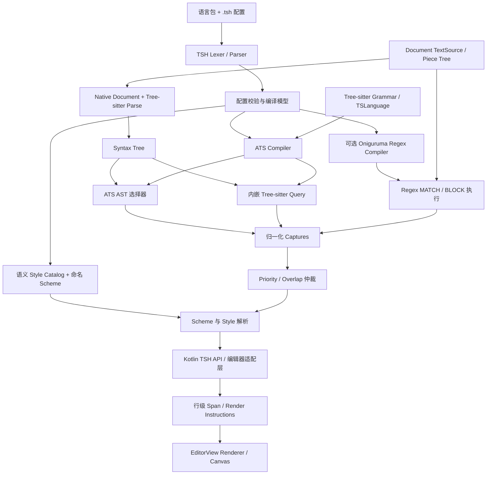
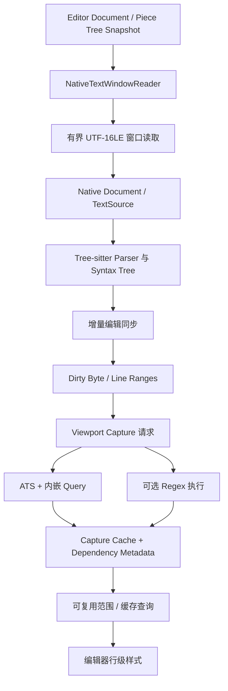

  
  <h1>Android Windbell Tree-sitter</h1>
  
<strong>面向 Android 的 Tree-sitter JNI 绑定、多语言语法模块与 Windbell TSH 高亮引擎。</strong>

  
<a href="README.md">English</a> · <a href="docs/README.md">文档中心</a> · <a href="https://github.com/msmt2018/Android-Windbell-TreeSitter">GitHub 仓库</a> · <a href="https://tree-sitter.github.io/tree-sitter/">Tree-sitter</a> · <a href="https://jitpack.io/#msmt2018/Android-Windbell-TreeSitter">JitPack</a>

---

## 项目简介

**Android Windbell Tree-sitter** 是面向 Android 编辑器和开发工具的 Tree-sitter 集成项目。仓库包含统一 JNI 绑定层、Tree-sitter Native 运行时、独立语言语法模块，以及 **Windbell TSH（Tree-sitter Highlighting）高亮引擎**。

项目面向需要语法树解析、语言结构信息、增量文档处理和语法高亮能力的 Android 应用。

### 核心能力

- **Android JNI 绑定：** 由唯一的正式绑定模块 <code>android-tree-sitter</code> 向 Java / Kotlin 暴露 Tree-sitter API。
- **模块化 Grammar：** 各语言解析器可独立构建为 Android Native Library，应用按需依赖语言模块。
- **Windbell TSH：** 使用 <code>.tsh</code> 配置文件，组合 Tree-sitter ATS 选择器 / Native Tree-sitter Query 与可选的独立 Oniguruma Regex 规则执行路径。
- **语义样式与主题：** <code>.tsh</code> 可声明语言元数据、编辑器行为、样式目录、浅色 / 深色调色板和高亮规则。
- **大文档基础设施：** Native 文本源适配器包含有界窗口读取、映射文件 / 文件窗口和 Piece Tree 支持，并提供增量解析及视口捕获接口供编辑器集成。
- **Android 渲染集成：** 编辑器侧适配层将 TSH 捕获结果和解析后的样式转换为 Android 文本 Span。

TSH 高亮体系严格采用 **Tree-sitter ATS / Tree-sitter Query + 可选 Regex**。项目不使用 Monarch 高亮管线，也不依赖生成的 <code>.scm</code> 高亮管线。

> 大文件支持属于架构能力，不代表所有设备、语法和编辑器场景都具有固定性能保证。实际解析、捕获和最终屏幕绘制性能取决于语法复杂度、文档结构、设备内存和编辑器集成方式。评估目标工作负载时应以仓库测试和真实设备测量为准。

## Windbell TSH —— Tree-sitter Highlighting 高亮引擎

**Windbell TSH** 是本仓库面向 Android 代码编辑器开发的声明式语法高亮与语言呈现引擎。语言包提供 Tree-sitter Grammar，`.tsh` 配置文件声明语言如何识别、匹配和着色，Native Runtime 生成带有源码范围的 Capture，最后由编辑器适配层将解析后的样式转换为真实的行渲染指令。

TSH 不是一套写死语言关键字和颜色的高亮规则集合。`.tsh` 是语言元数据、语义样式、主题方案、ATS 选择器、内嵌 Tree-sitter Query、可选 Regex 规则以及编辑器元数据的唯一配置来源。Native 核心保持通用，不内置某种语言的颜色或主题语义。

### 设计目标与核心特点

- **语法树感知高亮：** 基于真实 Tree-sitter Syntax Tree 进行结构匹配，不只依赖关键字列表。可以区分声明、引用、字段、嵌套结构、注释、字面量及 Grammar 定义的其他语法对象。
- **两条匹配管线、统一结果模型：** ATS / Tree-sitter Query 负责结构化语法匹配；可选 Oniguruma Regex 是独立的文本模式匹配管线。两者的结果在统一 Capture 模型中归一化后再进行仲裁。Regex 不混入 Tree-sitter Query 执行器。
- **配置驱动样式：** 语义样式名称、调色板、字体标志和 UI 主题 Token 均来自 TSH 配置。C++ 不写死语言颜色，也不通过数字 Style ID 推断样式含义。
- **Query 内嵌：** Tree-sitter Query 源码直接写在 `.tsh` 文件中，并针对所选 `TSLanguage` 编译，不需要生成或读取外部 `.scm` 高亮文件。
- **明确的规则优先级：** 规则可以声明 priority 和 overlap 行为；声明顺序提供稳定的次级排序。嵌套范围和互不冲突的区间不会被任意的“最后写入覆盖”策略丢弃。
- **切换主题不重新解析：** 命名 Scheme 与浅色 / 深色外观属于呈现数据。切换方案或外观时重新解析调色板即可，不需要重建语法树。
- **面向大文档的执行路径：** Native Document 支持有界窗口读取，可连接 Piece Tree 文本源，并提供编辑同步、脏区间报告、视口捕获和可复用捕获范围。
- **接入真实编辑器绘制：** TSH 结果进入编辑器 SyntaxHighlighter / 行样式链路。编译成功或捕获成功不等于像素已经绘制，最终 Draw 由宿主 Renderer 负责。

### TSH 工作原理与处理架构

下图展示 TSH 的整体数据流。ATS 与 Regex 在执行阶段相互独立，直到结果归一化后才进入统一样式仲裁。

#### 运行时分层

| 层级 | 主要职责 |
| --- | --- |
| `.tsh` 配置 | 声明语言身份、文件关联、语义样式、主题方案、ATS / Query 规则、可选 Regex 规则和编辑器元数据 |
| Lexer / Parser | 解析配置词法与语法，发现格式错误并提供源码诊断 |
| Compiler / Validator | 解析 Style 引用、校验 Grammar 节点与字段、编译内嵌 Tree-sitter Query 和 Oniguruma 表达式，构建运行时规则 |
| Tree-sitter / ATS | 遍历语法树，执行节点 / 字段 / 关系选择器及内嵌 Native Query |
| Oniguruma Regex | 独立执行可选文本模式、Capture 和 begin/end 块区域规则 |
| Capture 归一化 | 将结果转换为文档相对范围，同时保留来源、样式、优先级、声明顺序和 overlap 元数据 |
| Style / Scheme Resolver | 解析语义 Style、继承属性、当前命名 Scheme 和浅色 / 深色调色板 |
| Kotlin / Editor Adapter | 暴露配置元数据与捕获结果，连接文档 / 编辑器，并将样式投影为行级渲染数据 |
| 宿主 Renderer | 应用支持的文本属性并绘制实际编辑器画面 |

### TSH 配置可以描述什么

TSH 配置采用声明式设计。配置负责描述语言和呈现规则，Native 引擎不内置语言专属颜色。

#### 1. 语言身份与文件关联

语言配置可以声明稳定的语言 ID、显示名称、文件扩展名、别名、MIME 类型和可选的首行匹配表达式。运行时可利用这些元数据将文件关联到 Grammar / Profile。仓库还提供 Grammar Registry / Provider 和语言解析器，可综合文件后缀、MIME、Shebang、首行规则及支持的内容前缀特征进行识别。

Grammar Library 和 TSH Profile 是两个独立资源：安装某种 Parser 并不意味着自动获得了完整的语言高亮配置。

#### 2. 语义 Style Catalog

`styles` 用于声明语义样式名称，例如 `keyword`、`type`、`function`、`variable`、`string`、`comment` 和 `number`。每个 Style 可以声明：

- TextMate 风格的点分隔 `scope`；
- 开放式语义 `tags`；
- 描述文本；
- 用于逐属性继承的 parent Style；
- 弃用标记和字符串类型 metadata。

Style ID 仅作为运行时句柄。应用和主题应通过语义名称访问样式，不应依赖数字 ID 的具体值。

#### 3. 命名 Scheme、浅色 / 深色调色板与 UI Token

一个 TSH 配置可以定义多个命名 Scheme。每个 Scheme 可以分别为浅色和深色外观提供语义样式颜色，也可以提供 UI Token，例如编辑器背景、前景、选区、当前行高亮、Gutter、光标、工具栏、Tab 和状态栏 / 导航栏表面颜色。

支持的设计能力包括 Scheme 继承、语义 Style 继承、显式颜色存在性标记、包含 Alpha 的 ARGB 颜色，以及在当前 Renderer 支持范围内的粗体、斜体、下划线、删除线和 dim 等字体属性。

缺失颜色表示 **不覆盖颜色**。TSH 不应擅自补成黑色、白色或依赖系统主题的替代色。这样才能保留配置文件中的精确颜色，并允许宿主编辑器在该 Style 没有声明前景色时继续使用原有前景色。

Scheme 和浅色 / 深色外观属于运行时呈现选择。切换它们应更新解析后的 Paint 数据，而不应重新编译 Grammar、Query 或 Syntax Tree。

#### 4. ATS —— Tree-sitter AST 节点选择器

ATS 选择器匹配真实 Tree-sitter 节点及其语法结构关系。当前实现的选择器模型包含节点类型、字段、父节点、祖先、子节点、前后兄弟节点、子节点索引、named / missing / extra / error 标记，以及精确文本、前缀、后缀和 Regex 文本条件等。

Field 选择器着色的是该字段对应的子节点，而不是父级声明节点。符号解析同时考虑 Grammar Symbol 与 Public Symbol 身份，避免节点别名导致选择器无声失配。

当着色规则依赖语法含义或结构时，ATS 尤其有用。例如：区分类声明中的类型名称与表达式中普通使用的标识符。

#### 5. 内嵌 Tree-sitter Query

TSH 配置可以在 `treeSitter.queries` 中直接声明 Native Tree-sitter S-expression Query。编译阶段使用当前 Grammar 的 `TSLanguage` 编译每条 Query，并将 Capture 名称绑定到语义 Style；Query Pattern 还可以携带优先级和启用状态等元数据。

Query 源码始终保存在 `.tsh` 中，不会转换成生成的 `.scm` 文件。Native 结果路径会保留 Query 捕获的文档范围及 Pattern / Capture 来源信息。

ATS 选择器与内嵌 Tree-sitter Query 都属于 Tree-sitter 结构化匹配，但面向不同的规则表达需求：ATS 用于声明节点关系约束，Query 用于表达 Tree-sitter 原生模式语言。

#### 6. 可选 Oniguruma Regex

Regex 是可选的独立文本匹配后端。当前 Native 规则模型区分：

- **MATCH 规则：** 在源文本中查找符合模式的文本；
- **BLOCK 规则：** 通过开始 / 结束分隔符跟踪一个区域，可分别配置区域样式、内容样式及嵌套规则。

Regex 规则可以将数字或命名 Capture Group 绑定到语义 Style，声明优先级和 overlap 行为，启用 / 禁用规则，并在编译器支持范围内复用配置文件中定义的正则片段。嵌套 `contains` 规则可用于实现注释或字符串区域内部的 TODO 标记等场景。

Regex 执行必须区分局部窗口和完整文档。编译器会保守判断某个模式是否具有已证明的有限匹配宽度。无法证明窗口执行安全性的模式必须使用足够的完整上下文路径或明确报告限制；不能因为匹配跨越窗口边界就静默漏掉结果。BLOCK 状态检查点属于独立的状态恢复机制，不等同于普通 Regex MATCH 执行。

#### 7. 规则优先级与 Capture 仲裁

ATS 与 Regex 的结果在统一视觉样式仲裁前先进行归一化。Capture 记录保留来源后端、Style ID、priority、declaration order 和 overlap 策略。Native 仲裁采用确定性排序，不依赖集合遍历顺序。

独占范围发生冲突时，高优先级 Capture 优先；合法的嵌套 Scope 和不冲突的区间片段可以共存。显式允许 overlap 时保留双方范围。相邻且兼容的输出片段可以合并，减少后续 Span 处理工作。

前景色、背景色与字体属性分别解析。一个只声明字体属性的 Capture 不应意外清除另一个活动 Capture 已明确配置的前景色。

### 大文档与增量编辑器处理路径

大文档路径的目标是避免每次视口请求都把整个文档重新物化为 Kotlin `String`，或复制成另一份完整 Native 字节数组。

这条路径的主要特性：

- **窗口化文本访问：** Native Document 通过宿主提供的 Reader 读取有界 UTF-16LE 字节窗口。当前 Native Document 契约使用 UTF-16LE 字节偏移量，偏移量和长度必须为偶数。
- **Piece Tree 集成：** 编辑器可以从 Piece Tree Snapshot 提供文本窗口，不必为了每次捕获请求而展平整个缓冲区。
- **增量解析：** 编辑器侧 `TshPieceTreeIncrementalSession` 在 Worker 上串行处理首次解析和编辑事务，合并待处理任务，并在活动 Native 工作结束后回收旧语法树。
- **脏区间传播：** Native Document 编辑接口可以报告 Dirty Byte / Line Ranges，使编辑器针对失效范围处理，而不是每次编辑都重置全文样式。
- **视口捕获：** 编辑器 Highlighter 请求可见行所需范围，并将尚未覆盖的区间交由后台任务处理。
- **捕获复用：** Capture 区间缓存与 Native Dependency Metadata 用于判断视口移动或编辑后，之前计算的范围是否仍然有效。当文档、Grammar、Query、Source 或 Partition 版本无法证明兼容时，必须拒绝复用。
- **Unicode 安全边界：** Native Document 使用 UTF-16LE 字节坐标。转换为编辑器 UTF-16 code unit / 行坐标时必须显式处理，不能混用坐标单位，也不能传入奇数 Byte Offset。

这并不意味着任意 Regex 表达式都能在固定大小窗口内执行，也不意味着所有大文件工作负载都具有固定延迟。正确性优先于有界执行：依赖完整上下文的规则必须保留足够上下文，或采用保守回退。

### Android 渲染与样式支持范围

仓库包含 Kotlin TSH Engine 和编辑器适配器，可将 TSH 结果接入编辑器 SyntaxHighlighter / 行样式链路。当前 `StyledTextPainter` 集成直接绘制：

- 前景色；
- 背景色；
- 粗体与斜体；
- 下划线；
- 删除线。

该 Painter 尚未实现的属性（例如字体族、字体大小）必须作为宿主元数据或未支持的渲染属性处理，不能描述为已经绘制。适配器负责为编辑器行解析 Span；最终 Draw 仍由宿主 `EditorView` / Canvas 负责。编译成功、Capture 成功、RenderPlan 更新或 invalidate 请求，都不能单独证明目标像素已经显示。

### TSH 的职责边界与支持性

| 能力 | TSH 的职责 |
| --- | --- |
| 语法高亮 | 支持 —— ATS 选择器、内嵌 Tree-sitter Query，以及可选 Regex |
| 语言元数据与文件关联 | 支持 —— Profile 元数据及 Grammar / Profile 解析能力 |
| 语义样式与主题 | 支持 —— 命名 Style Catalog、Scheme、浅色 / 深色调色板、UI Token |
| 编辑器行为元数据 | 支持声明 —— 注释、括号、自动闭合、缩进和 Enter 规则等；具体行为由宿主消费和实现 |
| 增量文档集成 | 已有源码路径 —— Native Document / Edit API 与编辑器 Piece Tree 集成 |
| 视口捕获与复用 | 已有源码路径 —— 范围捕获和缓存复用；是否有效取决于依赖记录和版本校验 |
| 最终像素和全部编辑器功能 | 宿主职责 —— Renderer 必须支持对应属性并实际完成绘制 |
| Language Server、补全 Provider、折叠、Outline 提取 | 不属于 TSH 高亮核心提供的功能 |

### 当前实现边界与使用注意事项

以下区别在接入引擎时必须明确：

1. 仓库目前包含 Java ATS-only 配置和 Java Hybrid 配置，分别演示纯结构化高亮以及 ATS + 可选 Regex 的组合。其他 Grammar 模块提供 Parser，并不会自动附带完整的语言专属 `.tsh` 高亮配置。
2. 当前编译器入口以已经实现的配置结构为准（包括 `ast`、`treeSitter.queries` 和 Regex `contains` 规则）。设计资料中描述的统一 `rules { ats { ... } regex { ... } } 门面并不是当前实际配置语法；生产配置不要直接使用尚未实现的语法。
3. DSL 规范同时记录已实现能力与规划能力。某个构造出现在设计规范中，并不代表当前 Compiler / Runtime 已经接受它。应以当前示例配置、编译器源码和测试为准。
4. 新的统一 TSH API Foundation 正在逐步接入。当前 Native 高亮仍以既有 `WindbellTshEngine` 作为兼容执行入口；不能将新门面已初始化误认为整个 Native 高亮链路已完成迁移。
5. Native Document、大文件、缓存和增量处理源码路径已经存在，但其性能和正确性仍需通过对应 Gradle、Native、Android 设备和目标工作负载验证后，才能给出量化结论。

### TSH 源码与实现文档

- [TSH DSL v2 规范](docs/TSH_DSL_V2_SPEC.md)
- [TSH 重构计划与实现状态](docs/TSH_REWORK_PLAN.md)
- [TSH 高亮准确性与渲染完整性](docs/TSH_HIGHLIGHT_ACCURACY_AND_RENDERING_INTEGRITY.md)
- [大文本 Native Token 架构](docs/TSH_LARGE_TEXT_NATIVE_TOKEN_ARCHITECTURE.md)
- [TSH 引擎完成度与性能路线图](android-tree-sitter/TSH_ENGINE_COMPLETION_AND_PERFORMANCE_ROADMAP.md)
- [Java ATS-only 配置](app/src/main/assets/tsh/java-ats-only.tsh)
- [Java Hybrid 配置](app/src/main/assets/tsh/java-hybrid.tsh)
- [TSH Native Kotlin Engine](android-tree-sitter/src/main/java/com/zerostudio/idea/treesitter/tsh/WindbellTshEngine.kt)
- [Piece Tree 增量会话](editor/src/main/java/x/github/module/editor/tsh/TshPieceTreeIncrementalSession.kt)
- [Android 编辑器 TSH Highlighter](app/src/main/java/com/zerostudio/idea/androidtreesitter/TshSyntaxHighlighter.kt)

---

## 引擎架构

~~~text
Android 编辑器 / 应用
        |
        +-- 编辑器集成与 Android Span 渲染
        |
        +-- Windbell TSH Kotlin API
        |      |
        |      +-- .tsh 解析、编译、样式与调色板
        |      +-- Tree-sitter ATS / Native Query 执行
        |      +-- 可选 Oniguruma Regex 执行
        |
        +-- android-tree-sitter JNI 绑定层
               |
               +-- Tree-sitter Native Runtime
               +-- 自动生成的 Grammar JNI 库
               +-- Native TextSource / Piece Tree / 映射文件适配器
~~~

<code>android-tree-sitter</code> 是项目唯一正式 JNI 绑定层，也是 TSH 引擎的归属模块。Grammar 模块依赖该绑定层，不额外引入第二套 Tree-sitter 绑定。

### 仓库目录结构

| 路径 | 用途 |
| --- | --- |
| <code>android-tree-sitter/</code> | Android Java/Kotlin API、JNI 实现、Tree-sitter Native 集成、TSH 引擎与测试 |
| <code>grammars/</code> | Grammar Git Submodule 与语法元数据 |
| <code>grammar-modules/</code> | Gradle 根据 <code>grammars/grammars.json</code> 在项目配置阶段生成的语法模块 |
| <code>tree-sitter-lib/</code> | Tree-sitter 源码 Submodule，包含构建使用的 CLI 源码 |
| <code>editor/</code> | 编辑器集成、Piece Tree / TSH 适配 |
| <code>piecetable/</code> | Piece Tree 实现 |
| <code>annotations/</code>、<code>annotation-processors/</code> | Native Header 与 JNI 注册注解处理 |
| <code>build-logic/</code> | Gradle 插件、Grammar 模块生成和构建逻辑 |
| <code>app/</code> | Android 示例应用与集成测试 |
| <code>docs/</code> | TSH 语言规范、架构、渲染和开发文档 |

## 快速开始：使用 Tree-sitter

### 1. 添加 JitPack 仓库

在使用方 Android 项目的 <code>settings.gradle.kts</code> 中添加：

~~~kotlin
dependencyResolutionManagement {
    repositoriesMode.set(RepositoriesMode.FAIL_ON_PROJECT_REPOS)
    repositories {
        google()
        mavenCentral()
        maven { url = uri("https://jitpack.io") }
    }
}
~~~

### 2. 添加核心绑定和所需 Grammar 依赖

本仓库属于多模块 Gradle 项目。JitPack 单独模块依赖的坐标格式如下：

~~~kotlin
dependencies {
    implementation("com.github.msmt2018.Android-Windbell-TreeSitter:android-tree-sitter:VERSION")
    implementation("com.github.msmt2018.Android-Windbell-TreeSitter:tree-sitter-java:VERSION")
}
~~~

将 <code>VERSION</code> 替换为已经由 JitPack 成功构建的 Git Tag 或 Commit 版本。每种语言按需添加一个 <code>tree-sitter-&lt;language&gt;</code> 模块，不需要默认引入全部 Grammar。

**当前发布流程：** <code>release-jitpack.yml</code> 首先完整构建 Gradle 项目，然后验证全部 60 个 Maven Publication 均可发布到 Maven Local；只有这两个阶段全部成功后才会创建并推送版本 Tag。随后由 JitPack 按需构建/缓存 Tag 对应模块并提供 Maven 工件。GitHub Actions 构建成功不等于 JitPack 工件已可下载，正式使用前仍需在 [JitPack 项目页面](https://jitpack.io/#msmt2018/Android-Windbell-TreeSitter)核对 JitPack 构建结果及目标 AAR/POM。

### 3. 解析源码

下面使用自动生成的 Java Grammar 绑定：

~~~java
import com.zerostudio.idea.treesitter.TreeSitter;
import com.zerostudio.idea.treesitter.TSNode;
import com.zerostudio.idea.treesitter.TSParser;
import com.zerostudio.idea.treesitter.TSTree;
import com.zerostudio.idea.treesitter.java.TSLanguageJava;

public final class ParseExample {
    public static void parse(String source) {
        TreeSitter.loadLibrary();

        try (TSParser parser = TSParser.create()) {
            parser.setLanguage(TSLanguageJava.getInstance());

            try (TSTree tree = parser.parseString(source)) {
                if (tree == null) {
                    throw new IllegalStateException("Tree-sitter did not return a syntax tree");
                }

                TSNode root = tree.getRootNode();
                String rootType = root.getType();
                // 在这里读取节点类型、范围、字段和子节点。
            }
        }
    }
}
~~~

使用解析器 API 前先加载核心 Native Library。Native 对象应在所有权结束时及时释放；示例通过 try-with-resources 管理 <code>TSParser</code> 和 <code>TSTree</code>。

## 快速开始：加载 TSH 配置

TSH 引擎包含在 <code>android-tree-sitter</code> 模块中。Grammar 模块提供对应的 <code>TSLanguage</code> 实例，<code>.tsh</code> 文件提供高亮规则与样式配置。

~~~kotlin
import com.zerostudio.idea.treesitter.java.TSLanguageJava
import com.zerostudio.idea.treesitter.tsh.WindbellTshEngine

fun loadJavaTshProfile() {
    val language = TSLanguageJava.getInstance()
    val source = assets.open("tsh/java-ats-only.tsh")
        .bufferedReader()
        .use { it.readText() }

    val engine = WindbellTshEngine.instance
    val loaded = engine.loadTshSource(
        extension = "java",
        tshSourceContent = source,
        language = language
    )

    check(loaded) {
        engine.lastCompileDiagnostics.joinToString("\n") {
            it.line.toString() + ":" + it.column + " " + it.code + ": " + it.message
        }
    }
}
~~~

示例中的配置文件路径来自示例应用的 assets。实际应用可以将自己的 <code>.tsh</code> 配置放入 assets，或从应用配置源读取。

### TSH 文档与编辑器集成流程

编辑器集成的基本流程：

1. 加载 Grammar Native Library，并获取对应的 <code>TSLanguage</code>。
2. 调用 <code>WindbellTshEngine.loadTshSource</code> 加载并编译对应的 <code>.tsh</code> 配置。
3. 通过 <code>NativeTextWindowReader</code> 和 <code>createNativeDocument</code> 提供文档数据。
4. 调用 <code>highlightNativeDocument</code> 请求所需字节区间的高亮捕获结果。
5. 使用当前 TSH 调色板解析捕获结果中的样式 ID，并由编辑器渲染层应用样式。
6. 文档编辑提交后，将编辑区间同步到 Native 文档，并刷新失效的编辑器区间。
7. 编辑器会话结束时关闭 Native 文档。

Native 文档读取接口使用 **UTF-16LE 字节偏移量**，传入的偏移量和长度必须为偶数。对于大文档，应将 Reader 连接到编辑器 Piece Tree 或其他窗口化文本源；不要为了满足 Reader 接口而额外创建整份文档的完整字节数组副本。

实现参考：

- <code>editor/src/main/java/x/github/module/editor/tsh/TshPieceTreeEditorBinding.kt</code>
- <code>editor/src/main/java/x/github/module/editor/tsh/TshPieceTreeTextAccessProvider.kt</code>
- <code>editor/src/main/java/x/github/module/editor/tsh/TshPieceTreeIncrementalSession.kt</code>
- <code>app/src/main/java/com/zerostudio/idea/androidtreesitter/TshSyntaxHighlighter.kt</code>
- <code>android-tree-sitter/src/main/java/com/zerostudio/idea/treesitter/tsh/WindbellTshEngine.kt</code>

## 已有 Grammar Language

仓库当前包含以下 Grammar Submodule。Gradle 会根据 <code>grammars/grammars.json</code> 中的每个条目生成对应的 <code>tree-sitter-&lt;language&gt;</code> 模块。

| 分类 | Grammar 标识符 |
| --- | --- |
| Android 与 Native | <code>aidl</code>、<code>arm64</code>、<code>asm</code>、<code>c</code>、<code>cmake</code>、<code>cpp</code>、<code>disassembly</code>、<code>llvm</code>、<code>llvm_mir</code>、<code>smali</code> |
| Shell 与构建配置 | <code>bash</code>、<code>containerfile</code>、<code>dockerfile</code>、<code>gdb</code>、<code>make</code>、<code>starlark</code>、<code>zsh</code> |
| C 系与 JVM | <code>csharp</code>、<code>go</code>、<code>gomod</code>、<code>groovy</code>、<code>java</code>、<code>kotlin</code>、<code>rust</code>、<code>swift</code> |
| Web 与脚本语言 | <code>dart</code>、<code>javascript</code>、<code>jsdoc</code>、<code>lua</code>、<code>php</code>、<code>ruby</code>、<code>scss</code>、<code>svelte</code>、<code>typescript</code>、<code>vue</code> |
| 数据与配置 | <code>csv</code>、<code>gitattributes</code>、<code>gitcommit</code>、<code>gitignore</code>、<code>git_rebase</code>、<code>graphql</code>、<code>ini</code>、<code>json</code>、<code>logcat</code>、<code>markdwon</code>、<code>properties</code>、<code>proto</code>、<code>regex</code>、<code>requirements</code>、<code>sql</code>、<code>ssh</code>、<code>toml</code>、<code>xml</code>、<code>yaml</code> |
| 文档格式 | <code>asciidoc</code>、<code>diff</code>、<code>rst</code> |

以上标识符保持仓库实际 Grammar 目录名称，包括当前目录中使用的 <code>markdwon</code> 拼写。

Grammar 存在于 Git Submodule 中，不代表它已经发布到所有 Maven 仓库。添加 Maven 依赖前，应检查目标仓库中实际可用的模块和版本。

## Grammar 元数据生成：<code>generate_grammars.py</code>

在仓库根目录执行：

~~~bash
python generate_grammars.py
~~~

该脚本维护 <code>grammars/grammars.json</code>，Gradle 的 <code>DynamicModulePlugin</code> 会读取该文件并动态生成语法模块。

### 脚本具体工作

1. 读取 <code>.gitmodules</code>，提取所有注册在 <code>grammars/</code> 下的 Submodule 路径。
2. 将 Submodule 路径与当前已经检出的本地 Grammar 目录取交集。未初始化的 Submodule 不会被误认为本地可用语法。
3. 递归扫描 Grammar 目录，查找 <code>src/parser.c</code> 或 <code>src/parser.cc</code>。
4. 跳过隐藏目录，以及 <code>node_modules</code>、<code>.git</code>、<code>.github</code>、<code>build</code>、<code>target</code> 等排除目录。
5. 尽可能从 parser 源码中提取真实导出的 <code>tree_sitter_*</code> C 入口符号，而不是单纯猜测函数名称。
6. 自动识别 Composite Grammar，并记录嵌套的 <code>sub.paths</code> 与一一对应的 <code>sub.entries</code>。
7. 检测 <code>scanner.c</code> 或 <code>scanner.cc</code>，并记录到 <code>src.extra</code>。
8. 先写入临时文件，再生成 <code>grammars/grammars.json</code>。

JSON 使用两种结构描述 Grammar：

- 单解析器：使用 <code>entry</code> 记录 C 入口符号。
- Composite 多解析器：使用 <code>sub.paths</code> 和 <code>sub.entries</code> 记录各个子解析器及入口符号。

此外，<code>src.extra</code> 用于记录需要一起编译的外部 Scanner 源文件。Gradle Settings 插件读取 JSON 后，会在 <code>grammar-modules/&lt;language&gt;</code> 下生成模块构建文件、JNI glue 和 CMake 配置。

**特别注意：** <code>generate_grammars.py</code> 负责生成 Grammar 模块元数据，不负责生成 Tree-sitter parser 源码。被扫描的 Grammar Submodule 中必须已经存在 parser 源文件。Tree-sitter CLI / Gradle Grammar 任务负责 Parser 生成和 Native 编译。

新增、移除或调整 Grammar Submodule 后执行：

~~~bash
git submodule update --init --recursive
python generate_grammars.py
~~~

检查 <code>grammars/grammars.json</code> 的变更后再提交。

详细说明见：[README_grammars.md](README_grammars.md)。

## 从源码构建项目

### CI 使用的工具链版本

以下版本来自当前 GitHub Actions 构建工作流和 Gradle Version Catalog：

| 组件 | 版本 / 要求 |
| --- | --- |
| Gradle 运行 JDK | Temurin 17 |
| Gradle Wrapper | 8.14.8 |
| Android Gradle Plugin | 8.13.2 |
| Kotlin Gradle Plugin | 2.4.21 |
| Android NDK | r29 / <code>29.0.14206865</code> |
| Android CMake | 3.31.6 |
| Android Build Tools | 35.0.0 |
| Android compile SDK | API 34 |
| Android minimum SDK | API 21 |
| Python | 3.12 |
| Node.js | 22.22.2 |
| Rust / Cargo | 构建仓库内 Tree-sitter CLI 所需 |
| Bun | Grammar package 工作流使用 |
| Native 主机工具 | C/C++ 编译器、<code>build-essential</code>、CMake、Ninja |

注意：Gradle 运行环境的 JDK 版本与 Android 源码 / 字节码兼容级别是不同配置。构建项目时使用 **JDK 17**；共享 Android 编译配置目标为 Java 11。

### Windows 环境配置

最接近 CI 的 Windows 开发环境是 **Windows 10/11 + WSL2（Ubuntu）**。仓库 CI 运行在 Ubuntu，使用 Bash、Cargo、CMake、Ninja、Node package 安装和 Native 主机测试。

在 Windows Android Studio 中配置：

1. 安装 Android Studio 和 Android SDK。
2. 安装 JDK 17，例如 Eclipse Temurin 17。
3. 打开 **Android Studio → Settings → Build, Execution, Deployment → Build Tools → Gradle**，将 **Gradle JDK** 设置为 JDK 17。
4. 在 **SDK Manager → SDK Platforms** 中安装 Android API 34。
5. 在 **SDK Manager → SDK Tools** 中安装 Android SDK Build-Tools 35.0.0、NDK (Side by side) 29.0.14206865、CMake 3.31.6 和 Android SDK Command-line Tools。
6. 安装 Git for Windows（包含 Git Bash）、Python 3.12、Node.js 22.22.2、Rust/Cargo 和 Bun。确保终端能够找到 <code>git</code>、<code>bash</code>、<code>python</code>、<code>node</code>、<code>npm</code>、<code>cargo</code>、<code>cmake</code> 和 <code>ninja</code>。
7. 递归克隆仓库 Submodule，然后在 Android Studio 中打开仓库根目录。

~~~powershell
git clone --recurse-submodules https://github.com/msmt2018/Android-Windbell-TreeSitter.git
cd Android-Windbell-TreeSitter
git submodule update --init --recursive
python generate_grammars.py
.\gradlew.bat assembleDebug
~~~

Java Grammar ABI 重新生成任务会调用 Bash 脚本。如果在原生 Windows 环境构建，必须确保 Bash 已加入 <code>PATH</code>。需要执行与 CI 一致的 Host JNI 和 Sanitizer 测试时，建议使用 WSL2 Ubuntu；当前仓库工作流基于 Linux，Windows 尚未列入 CI 矩阵。

### Linux 环境配置（Ubuntu）

安装 CI 使用的 Native 系统依赖：

~~~bash
sudo apt-get update
sudo apt-get install -y build-essential cargo cmake ninja-build git curl unzip
~~~

安装并选择以下工具版本：

- Temurin JDK 17
- Python 3.12
- Node.js 22.22.2 与 npm
- Bun
- Android SDK Command-line Tools
- Android NDK 29.0.14206865
- Android CMake 3.31.6
- Android Build Tools 35.0.0

在 Android Studio 中将 **Gradle JDK 设置为 JDK 17**，并安装 Android API 34 及上述 SDK 工具。也可以配置 <code>ANDROID_SDK_ROOT</code> 指向 SDK 目录，并使用 <code>sdkmanager --licenses</code> 接受 Android SDK 许可证。

~~~bash
git clone --recurse-submodules https://github.com/msmt2018/Android-Windbell-TreeSitter.git
cd Android-Windbell-TreeSitter
git submodule update --init --recursive
python3 generate_grammars.py
chmod +x ./gradlew
./gradlew assembleDebug
~~~

### 安装 Grammar package 依赖

CI 工作流会扫描 Grammar Submodule 中的 <code>package.json</code>，安装各个独立 package 根目录，并跳过已经由 npm workspace 管理的子 package。安装命令使用 <code>npm install --legacy-peer-deps --no-audit --no-fund</code>，并发数量受到控制。

某个 Grammar 需要本地 npm 依赖时，在对应目录中安装。例如：

~~~bash
cd grammars/cpp
npm install
cd ../..
~~~

不要在每个嵌套 workspace 子目录中无差别重复执行 <code>npm install</code>；应先识别 workspace 根目录并只安装一次。

### 构建 Release APK

Linux / macOS / WSL2：

~~~bash
./gradlew assembleRelease generateDebugSymbolsRelease --parallel --stacktrace
~~~

Windows PowerShell：

~~~powershell
.\gradlew.bat assembleRelease generateDebugSymbolsRelease --parallel --stacktrace
~~~

示例 APK 输出目录为 <code>app/build/outputs/apk/release/</code>。

### 执行本地测试

CI 使用的主要本地测试命令：

~~~bash
./gradlew testDebug :editor:compileDebugAndroidTestKotlin :app:compileDebugAndroidTestKotlin --continue --parallel --stacktrace
~~~

Windows PowerShell：

~~~powershell
.\gradlew.bat testDebug :editor:compileDebugAndroidTestKotlin :app:compileDebugAndroidTestKotlin --continue --parallel --stacktrace
~~~

工作流还会在 Linux 主机执行 Native 测试，包括带 ASan/UBSan 的大文件存储测试和 Native TSH 缓存测试。对应的测试配置示例：

~~~bash
cmake -S android-tree-sitter/src/main/cpp/largefile/tests -B build/largefile-tests -DCMAKE_BUILD_TYPE=Debug
cmake --build build/largefile-tests --parallel 2
ASAN_OPTIONS=detect_leaks=1:halt_on_error=1 UBSAN_OPTIONS=halt_on_error=1:print_stacktrace=1 \
  ctest --test-dir build/largefile-tests --output-on-failure

./gradlew :android-tree-sitter:generateNativeHeadersDebug --stacktrace
cmake -S android-tree-sitter/src/main/cpp -B build/host \
  -DCMAKE_BUILD_TYPE=Debug \
  -DBUILD_TESTING=OFF \
  -DAUTOGEN_HEADERS="$PWD/android-tree-sitter/build/generated/native_headers"
cmake --build build/host --target android-tree-sitter --parallel 2
~~~

完整设备测试矩阵请查看 <code>.github/workflows/build.yml</code>。当前工作流使用 Android Emulator API 26、30 和 35。

### Android Studio 项目配置

- 打开仓库根目录，即包含 <code>settings.gradle</code> 的目录，不要单独打开某个子模块。
- 将 Gradle JDK 设置为 17。
- 通过 SDK Manager 安装 API 34、Build Tools 35.0.0、NDK 29.0.14206865 和 CMake 3.31.6。
- 等待 Gradle Sync 完成；Settings 插件会根据 <code>grammars/grammars.json</code> 生成 Grammar 模块。
- 不要手动修改 <code>grammar-modules/</code> 下的生成文件，应修改 Grammar 元数据或生成器输入。
- SDK 路径保存在本机 <code>local.properties</code> 中，不要提交机器专属 SDK 路径。

## Maven 包与 JitPack

需要区分两种不同的分发方式：

- **JitPack：** 当前唯一的项目 Maven 分发渠道。发布工作流先完整构建项目并验证全部 60 个 Maven Publication 可写入 Maven Local，成功后才创建 Git Tag；JitPack 随后按需构建/缓存各模块并提供依赖。
- **GitHub Packages：** 不再用于本项目的 Maven Release 发布。

使用 JitPack 时，先在仓库查询页面确认目标 Tag / Commit 构建成功，并且目标模块已列出。对于本多模块仓库，单独模块的依赖坐标形式为：

~~~kotlin
dependencies {
    implementation("com.github.msmt2018.Android-Windbell-TreeSitter:android-tree-sitter:VERSION")
    implementation("com.github.msmt2018.Android-Windbell-TreeSitter:tree-sitter-java:VERSION")
}
~~~

以 JitPack 页面实际显示的 artifact 名称为准。将 Java 示例替换为应用所需的 Grammar 模块。Grammar 模块依赖核心绑定模块，因此通常同时添加核心绑定和所选语言模块。

分支快照或 Commit 构建应使用 JitPack 页面为对应分支或 Commit 提供的版本写法。JitPack 版本规则和构建要求可能变化，请以官方 [Android 发布指南](https://docs.jitpack.io/android/) 和 [构建指南](https://docs.jitpack.io/building/) 为准。

## 更多文档

- [完整文档中心](docs/README.md) —— 架构、Java/Kotlin API 参考、TSH DSL v2 规范与语法、SCM 迁移、引擎指南、诊断规范和开发路线图。
- [Grammar 模块元数据与生成说明](README_grammars.md)
- [TSH DSL v2 规范](docs/TSH_DSL_V2_SPEC.md)
- [TSH 大文本 Native Token 架构](docs/TSH_LARGE_TEXT_NATIVE_TOKEN_ARCHITECTURE.md)
- [TSH 高亮准确性与渲染完整性](docs/TSH_HIGHLIGHT_ACCURACY_AND_RENDERING_INTEGRITY.md)
- [TSH 极限优化与闪烁修复](docs/TSH_EXTREME_OPTIMIZATION_AND_FLICKER_REMEDIATION.md)
- [TSH 引擎完成度与性能路线图](android-tree-sitter/TSH_ENGINE_COMPLETION_AND_PERFORMANCE_ROADMAP.md)
- [Java ATS-only 示例配置](app/src/main/assets/tsh/java-ats-only.tsh)
- [构建与测试工作流](.github/workflows/build.yml)
- [JitPack 发布工作流](.github/workflows/release-jitpack.yml)
- [JitPack 构建配置](jitpack.yml)

## 许可证

本仓库由项目维护者持有版权的代码采用 **GNU Affero 通用公共许可证第 3 版（AGPL-3.0-only）**。完整许可证文本见 [LICENSE](LICENSE)。第三方组件（包括 Git Submodule 和 Grammar 源码）仍遵循各自上游的许可证条款，请查看对应目录中的许可证文件及版权声明。
