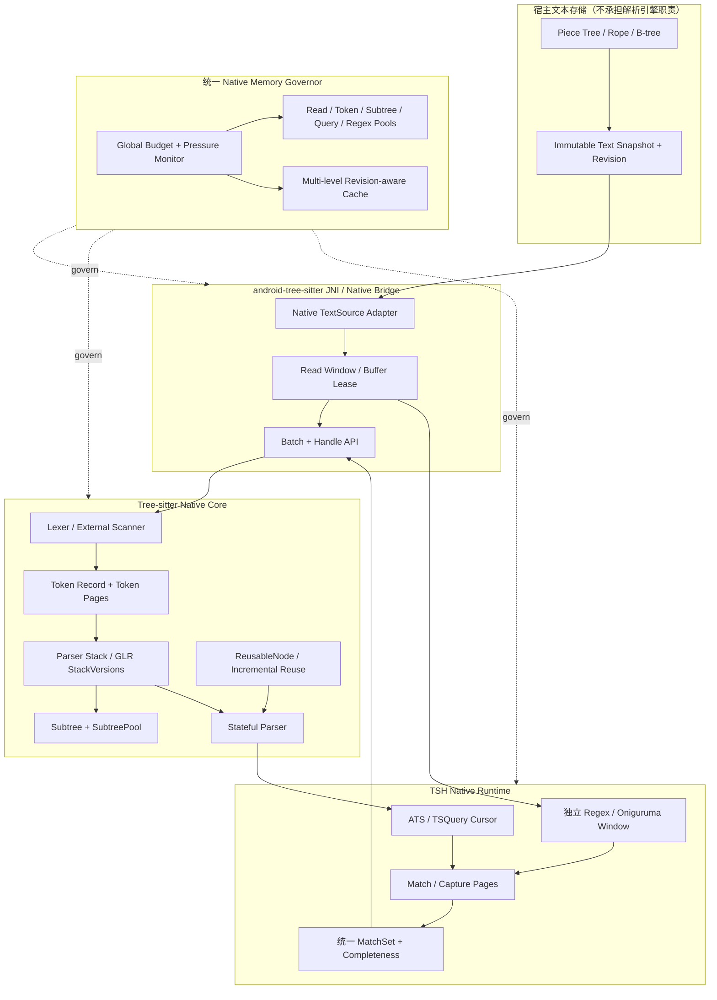
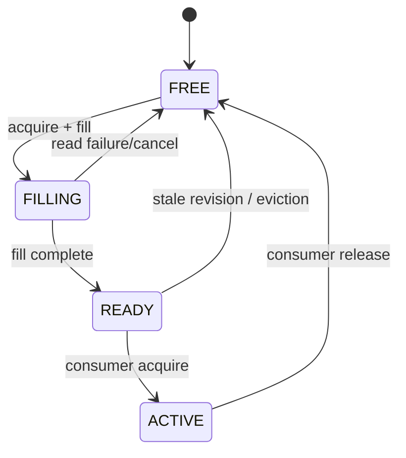
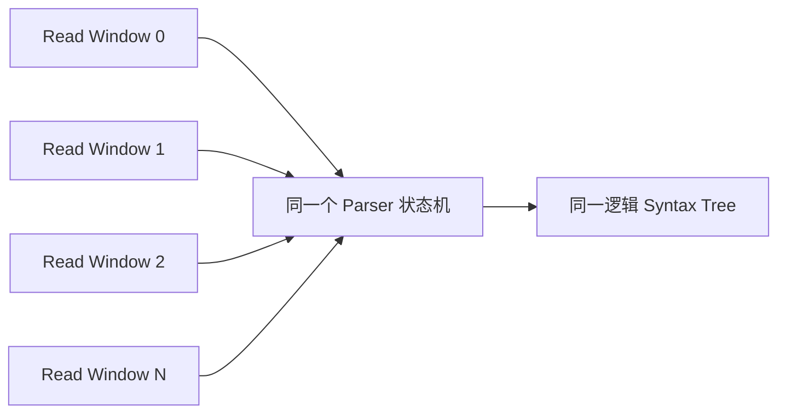
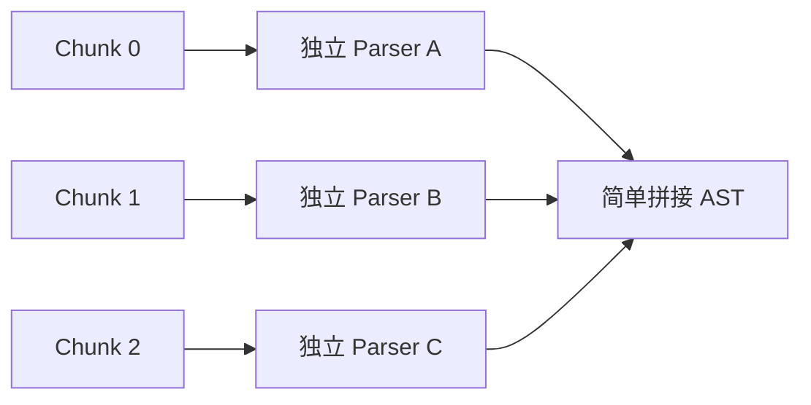

# TSH / Tree-sitter 超大文本 Token 与 Native 分块处理技术理论及架构设计

> 文档类型：技术理论、业界技术调研、核心框架与架构设计  
> 适用仓库：`msmt2018/Android-Windbell-TreeSitter`  
> 适用模块：`treesitter`、`android-tree-sitter` JNI/Native、TSH C++ Runtime、ATS/Tree-sitter Query、独立 Regex/Oniguruma  
> 设计重点：**在 Tree-sitter JNI 绑定源码和 TSH 引擎内部，建立能够承载超大量 Token、节点、匹配结果和分块输入的 Native 处理体系。**  
> 非目标：不把大文本能力转嫁给应用层文件对象，不要求应用层先将全文读入 String、Piece Tree 后再 flatten 成连续大缓冲区，也不以应用层独立分块解析来替代 Native 引擎的能力。  
> 状态：架构设计与技术理论文档；不代表所有机制已实现、构建或设备验证。

---

## 0. 核心结论

本项目的大文本演进方向不是“应用层先把文件处理成小块，再把每一块交给 Tree-sitter”，而是：

1. **Native 引擎原生支持有界、按需、可重复定位的文本读取。** JNI 层只负责把 Native TextSource 与宿主文本存储连接起来，不要求生成全文副本。
2. **Token 生产、Token 暂存、Subtree 构建、Query Match/Capture 输出采用分层内存体系。** 不再让所有对象都依赖单次大 vector、单次连续分配或一次性全量物化。
3. **分块是数据访问与资源调度单位，不是语法隔离边界。** Parser 的语法状态、外部扫描器状态、解析栈分支和 Tree 结构必须跨读取块连续演进。
4. **文本存储树、语法 Subtree、解析栈分支是三种不同结构。** 它们各自解决不同问题，通过稳定的绝对坐标和 revision 连接。
5. **缓存采用多级、多用途、有预算的缓存池。** 缓存必须有明确 key、版本、所有权、淘汰策略和失效原因；不能只增加缓存数量。
6. **大规模 Token 不应全部转成 JVM 对象。** Native 内部优先使用紧凑、分段、批处理表示；只有需要跨 JNI 边界或进入宿主 UI 的数据才转换为稳定的公共结果。
7. **增量解析优先复用 Tree-sitter 原有的旧树编辑与 Subtree reuse 机制。** 不另造一套与 Tree-sitter 竞争的第三解析管线。
8. **内存预算必须动态、有硬上限、可降级。** 既定设计约束：常规预算目标约 100 MiB，按设备与阶段自适应；总预算硬上限不得超过 512 MiB。预算是引擎全部相关 Native 工作集的总账，不是每个缓存池都可以各自使用 512 MiB。

最终目标是：文件大小和 Token 数量增长时，内存使用由受控的分块、池化、复用、分页和窗口策略管理；解析与匹配语义仍然对应完整文档，不发生跨块漏 Token、错位、错误捕获或静默截断。

## 1. 问题定义：真正需要扩展的是 Native Token 引擎

### 1.1 目标不是只解决输入文本的大小

大文本场景的瓶颈至少包含以下几类：

| 层面 | 典型压力 | 需要的 Native 能力 |
|---|---|---|
| 输入读取 | 全文连续缓冲区过大、复制次数多 | 按需读取、稳定窗口、可重复定位 |
| Lexer / Token | Token 数量巨大、短 Token 高频分配 | Token 紧凑表示、分块输出、批量分配 |
| Parser | 语法状态跨块、GLR 多分支 | 状态连续、分支共享、可控栈版本 |
| Subtree | 节点数量巨大、分配/释放频繁 | inline 优化、池化、引用计数、结构复用 |
| Query | Match/Capture 数量巨大 | 范围查询、游标分页、预算、显式完整性 |
| Cache | 热区重复读取、重复词法分析 | 多级缓存、窗口复用、版本感知淘汰 |
| JNI | 大数组/对象批量转换、跨边界复制 | Native 批次、句柄/Lease、少量边界转换 |
| Regex | Oniguruma 需要稳定连续指针 | 有界连续 WindowLease、独立窗口池 |
| 内存 | 临时对象、缓存、树和结果同时驻留 | 全局预算、压力反馈、回收与降级 |

**必须避免的错误方向：** 只把文件切成若干块，应用层把每块读成 String，然后反复调用 JNI；或者先把 Piece Tree 内容完整复制到 Native 连续 buffer，再声称 Native 支持大文本。这两种方式只是移动了全文复制的位置，并没有解决引擎本身的 Token、节点、缓存和生命周期问题。

### 1.2 目标规模与约束

设计应覆盖：

- 常规目标：200–300 MiB 文本文件；
- 扩展目标：200–500 MiB 及更大文件，按设备内存、语法复杂度、Token 密度和操作类型分级；
- Token 密度：短 Token 密集、长 Token、超长行、极深嵌套、大量错误恢复节点；
- 工作模式：首次解析、增量编辑、视口查询、全文件 Query、Regex 窗口扫描；
- 设备环境：低内存 Android 设备、后台/前台切换、快速滚动和连续编辑。

内存约束：

- 约 100 MiB 是常规工作集的初始目标，不是固定分配量；
- 预算根据可用内存、文件大小、Token 密度、缓存命中率和当前阶段动态调整；
- 全部 TSH/Tree-sitter 相关 Native 工作集受统一硬上限约束，最高不超过 512 MiB；
- 发生压力时先淘汰可重建缓存，再缩小预取/并发/批次，再切换为流式或延迟处理；
- 不能因为一个缓存池、Parser、Query 或 Regex 子系统独立运行而突破全局预算。

## 2. 技术基础：必须利用而不是绕过 Tree-sitter 的原有机制

本节区分“Tree-sitter 已有能力”和“本项目建议扩展能力”。不要把建议方案误写成上游已经提供的 API。

### 2.1 TSInput：按需读取的 Native 输入接口

Tree-sitter C API 的 `TSInput` 通过 read callback 按 byte offset 和 point 读取文本片段。回调返回当前可读片段及长度，`bytes_read == 0` 表示文档结束。Parser 借用回调返回的内存，不接管其所有权；因此返回缓冲区必须在 Parser 读取期间保持有效。

这正是 JNI 层应采用的输入基础：

- Native Parser 通过 TextSource/Reader 请求指定绝对位置；
- TextSource 根据 Piece Tree、Rope、文件映射或其他宿主存储定位；
- 只将当前读取窗口提供给 Parser；
- 读取窗口由有界缓冲池管理，避免每次 callback 都创建新对象；
- callback 的缓冲区生命周期必须覆盖 Tree-sitter 对该片段的读取期；
- callback 返回长度、编码边界和 EOF 必须精确，不能把“当前块暂时无数据”误报为 EOF。

注意：`TSInput.read` 是分块输入接口，不等于 Tree-sitter 自动把整个解析任务并行拆成独立文件，也不等于所有内部 Token、Subtree 和 Query 结果都会自动分页。它解决的是输入供应方式；Token/缓存/结果容量仍需要在 Native 核心层单独审视。

### 2.2 增量解析与旧树复用

Tree-sitter 支持通过 `TSInputEdit` 描述文档变化，并在下一次 parse 时传入已编辑的旧 Tree。旧 Tree 中未受影响且满足复用条件的 Subtree 可以被复用，从而避免每次编辑都从头构建完整树。

本项目必须遵守：

- 编辑描述的 byte、point、旧结束位置、新结束位置必须与实际文本变更完全一致；
- Tree edit 与 TextSource revision 必须对应同一份文档变更；
- 旧 Tree 在被编辑和复用期间必须保持生命周期有效；
- 旧结果不能跨 document revision 回流；
- 对未受影响的 Subtree 优先复用，不要用应用层缓存伪造 Tree-sitter 的节点身份；
- 增量复用必须通过 Tree-sitter 的合法 reuse gate，不能因为“范围没变”就无条件重用。

### 2.3 Subtree、SubtreePool 与 inline 优化

用户提供的 Tree-sitter 核心源码快照中可以看到：

- `Subtree` 是解析树构建与复用的核心结构；
- 小型叶子节点在满足条件时可以 inline 存储，避免独立 heap allocation；
- 较大的 Subtree 使用 `SubtreeHeapData`；
- `SubtreePool` 管理可复用的堆节点；
- Subtree 使用引用计数控制共享节点的生命周期；
- Subtree 汇总子节点元数据，并维护长度、行列范围、错误成本、外部 Token 状态等信息。

这些机制说明 Tree-sitter 已经采用“小对象优化 + 池化 + 引用计数 + 子树复用”的思路。大文本扩展应该增强其预算、观测、批量分配和生命周期约束，而不是完全绕过 Subtree 层，另外创建一份与原树脱节的 Token 树。

### 2.4 TokenCache 与 ReusableNode

源码快照还包含 Parser 内部的 TokenCache，缓存当前 byte position 对应的 token，并将最后一个 external token 状态纳入缓存命中条件；Parser 还使用 ReusableNode 遍历旧树候选节点，并检查位置、解析状态、外部扫描器状态等条件后决定是否复用。

重要结论：

- 上游现有 TokenCache 是局部的 Token 复用机制，不应误认为已经具备“多级、多窗口、大规模 Token 缓存体系”；
- ReusableNode 是旧语法树节点复用机制，不是文本存储 Piece Tree；
- 新增多级缓存时，必须保留 parser state、lex mode、external scanner state、byte position 等语义约束；
- 不能只按 Token 文本相同来复用 Token。相同文本在不同解析状态下可能具有不同合法性。

### 2.5 GLR 解析栈分支不是文本分块

Tree-sitter 在语法冲突和错误恢复场景中可以维护多个 StackVersion。栈版本分支用于探索不同解析路径，并在可能时合并收敛的状态。源码中的最大版本数等常量是解析算法内部的控制策略。

必须区分：

- **GLR 分支**：同一输入位置/文档语义下的多个候选解析状态；
- **文本块**：为了输入和内存管理而划分的数据片段；
- **语法 Subtree**：解析结果中的结构化节点；
- **Piece Tree/Rope 分支**：文本存储结构中的树节点/持久化版本。

它们没有一一对应关系。不能让每个文本块创建一套彼此独立的 GLR 状态，再简单拼树。

## 3. 业界技术路线及其适用边界

### 3.1 VS Code Piece Tree：多缓冲 Piece Table + 红黑树

VS Code 的 Text Buffer Reimplementation 说明了几个关键经验：

- 不把全文拆成每行一个对象，避免对象数量和元数据开销远大于原文；
- 将输入分成多个 buffer，Piece 只引用 buffer、起点和长度；
- 为节点维护行分隔信息；
- 使用平衡树按子树累计长度/行数进行定位；
- 原始 buffer 可只读，编辑 buffer 可追加，减少搬移文本；
- 使用缓存和树节点摘要提高行定位效率；
- 通过实测发现 GC、行内容访问、对象分配可能比 insert/delete 更热。

对本项目的借鉴：

- TextSource 不应依赖单个巨大连续 String；
- Native 读取层可消费多段 buffer 的逻辑文本视图；
- 通过树摘要实现 offset/line 快速定位；
- 对大量 Token 的内存表示也应避免“一 Token 一个重量级对象”。

边界：Piece Tree 是文本存储与编辑数据结构，不是 Tree-sitter 的语法树，也不负责维护 Lexer 状态、Query Match 或 GLR Parser 状态。

### 3.2 Rope / B-tree / SumTree：分段文本与聚合指标

Rope 将文本分成叶子块，由平衡树组织。内部节点可存储子树的聚合指标，例如 UTF-8 长度、UTF-16 长度、换行数、字符数等。这样可以在不 flatten 全文的情况下执行定位、切片和局部编辑。

Xi Editor 的 Rope 设计强调不可变/持久化结构、子树共享和分块叶节点；其 Rope Science 进一步展示如何使用可组合的摘要指标进行文本查询、增量计算和最小化失效。

对本项目的借鉴：

- TextSource 可使用宿主已有 Piece Tree/Rope，也可以在 Native 内部维护只读索引视图；
- 索引摘要必须覆盖所有需要的坐标单位，不能只保存单一长度；
- TextSource 快照要稳定，跨线程读取不能看到混合版本；
- 分区边界的 UTF-8、UTF-16 和 CRLF 处理必须明确；
- 缓存应利用树节点摘要跳过无关区段，而不是遍历全文。

边界：Rope/SumTree 并不会自动解决语法上下文跨块问题。语法解析仍然必须由连续的 Parser 状态机维护。

### 3.3 Slab / Arena / Object Pool：大量短生命周期对象

高 Token 密度下，频繁 malloc/free 会带来分配器锁、碎片、元数据和缓存局部性成本。常见优化包括：

- Slab：按固定大小或尺寸等级分配对象页；
- Arena：一个阶段或任务批次统一分配，阶段结束统一回收；
- Object Pool：复用固定结构对象；
- Small Object Optimization：短小对象直接内联；
- SoA（Structure of Arrays）：将同类字段分列连续存储，提升批量遍历和缓存局部性。

对 Token/Match/Capture 的建议：

- Token 的热字段（symbol、start/end、flags、state id）使用紧凑布局；
- 大型可选元数据与冷字段分离；
- 短 Token 记录优先存放在 slab/page 中；
- 临时 Query Capture 批次使用可回收 arena；
- 逃逸到公共 API 的结果必须拥有独立稳定生命周期，不能引用已释放的临时 arena；
- 不得用固定最大 Token 数的巨型数组一次性预留全部内存。

### 3.4 Incremental Parsing / Structural Sharing

Tree-sitter、Xi Rope、Roslyn/Rust Analyzer 等系统展示了不同层次的增量思路：

- 复用未变化的语法子树；
- 使用持久化树共享未变化节点；
- 对计算结果按依赖关系缓存；
- 编辑后只重算受影响范围；
- 对无法证明依赖不受影响的缓存采取保守失效。

对本项目的原则：Tree-sitter 原有 Subtree reuse 是语法树增量的权威机制；TSH 的 Match/Style/Render 缓存需要单独建立 revision 和依赖失效规则，不能将“Capture 范围未碰到编辑位置”当成结果仍然有效的证明。

### 3.5 多缓冲与 Ring Buffer

多缓冲并不意味着无限缓存。它用于避免生产者与消费者争用同一内存，并允许当前窗口处理时预取下一窗口。

可借鉴：

- 双缓冲：一个 buffer 被 Parser 消费，另一个由 TextSource 填充；
- 三缓冲：当前消费、下一批准备、可回收/空闲；
- Ring Buffer：按顺序推进的扫描任务复用固定数量窗口；
- Buffer Pool：按尺寸等级租借连续内存；
- Window Lease：明确 buffer 的 owner、revision、base offset、编码和有效长度。

必须增加的约束：

- Parser read callback 返回的指针在其读取期间不可移动；
- buffer 不得在仍被 Parser/Regex 使用时回收；
- 同一个 Parser 的输入回调不能并发修改同一缓冲区；
- 双/三缓冲只优化 IO/读取与消费重叠，不代表可以并行解析同一个 Parser 状态；
- 若需要多个 Parser 并行，必须有明确的文档分区语义、边界状态传递和结果合并证明，不能仅复制 Parser 就宣称安全。

## 4. 三棵“树”与两个状态系统：总架构的核心区分

本项目至少涉及三类树结构与两类状态系统：

| 名称 | 归属 | 解决的问题 | 是否可以按文本块独立 |
|---|---|---|---|
| Text Storage Tree（Piece Tree/Rope/B-tree） | 文本存储层 | 逻辑文本定位、读取、编辑、摘要 | 叶块可独立存储，但逻辑文档统一 |
| Syntax Subtree（Tree-sitter Subtree） | 解析结果层 | 语法结构、节点复用、范围汇总 | 不可随意拆成独立语法文档 |
| Parse Stack Branch（GLR StackVersion） | Parser 状态层 | 冲突/错误恢复的候选解析路径 | 由 Parser 按语法状态管理 |
| Token/Window Cache Tree（建议扩展） | Native 缓存层 | Token/窗口定位、复用和淘汰 | 缓存条目分段，必须绑定全局 revision |
| Regex Window State | Regex/Oniguruma 层 | 连续窗口、边界上下文和扫描状态 | 仅在规则语义可证明时分窗 |

架构上禁止把以上对象压成一个通用的“ChunkNode”。每类对象的生命周期、索引、失效和并发规则都不同。

## 5. 目标总架构



图中 Host 只提供快照和读取能力；Token、Parser、Subtree、Query、Regex 的核心工作均由 Native 引擎负责。Native Memory Governor 对所有池和缓存统一核算，防止各子系统独立扩张。

## 6. Native TextSource：不 flatten 的统一文本读取抽象

### 6.1 抽象职责

建议在 Native 侧建立稳定的 TextSource 接口（名称可按现有代码规范调整）：

```cpp
struct TextSnapshotId {
  uint64_t document_id;
  uint64_t revision;
};

struct TextReadWindow {
  const uint8_t* data;
  uint64_t base_byte;
  uint32_t length_bytes;
  uint32_t encoding;
  uint64_t revision;
  void* lease;
};

class NativeTextSource {
public:
  virtual ~NativeTextSource() = default;
  virtual uint64_t byte_length() const = 0;
  virtual uint64_t utf16_length() const = 0;
  virtual uint64_t revision() const = 0;

  virtual bool acquire_window(
      uint64_t absolute_byte,
      uint32_t preferred_bytes,
      TextReadWindow* out) = 0;

  virtual void release_window(TextReadWindow* window) = 0;
};
```

以上为概念接口，不是要求直接复制的最终 ABI。实际实现需要处理 Tree-sitter 的 32-bit byte offset 限制、UTF-8/UTF-16 编码和 Android JNI 的生命周期。

### 6.2 关键契约

- 每次读取以绝对 offset 定位；
- 返回窗口必须标明 base offset、长度、编码和 revision；
- 窗口长度不得超过当前预算；
- 读取窗口在 lease 释放前不可移动、重分配或被覆盖；
- 同一个 snapshot 的多次读取必须观察到一致内容；
- EOF 只能在真实文档结束时返回；
- 读取失败、版本变化和 EOF 必须区分；
- 64-bit 绝对 offset 转成 Tree-sitter 32-bit offset 前必须检查，不允许截断；
- TextSource 不得隐式把整个文件复制为一个连续缓冲区；
- JNI callback 不能将 Java/Kotlin 临时对象指针长期保存在 Native 中。

### 6.3 与 Piece Tree 的连接方式

Piece Tree 可以通过只读 snapshot adapter 暴露：

1. 根据绝对偏移查找所在 Piece/Leaf；
2. 在不跨越不可连续物理段的情况下返回当前连续片段；
3. 如 Parser 需要更多数据，再按新的 offset 读取后续窗口；
4. 需要跨多个 Piece 时，由 Native ReadWindow Pool 将有限范围复制到一个有界连续 scratch window；
5. 只复制当前读取窗口，不复制全文。

这与“应用层先拼接全文再交给 JNI”有本质区别。Piece Tree 提供逻辑文本，Native 引擎决定读取窗口、Parser 进度、Token 分配和结果处理。

## 7. Token 大规模处理：分段 Token Page 与批次生命周期

### 7.1 Token 记录布局

建议把 Token 的高频字段与低频字段分离：

```cpp
struct TokenRecord {
  uint32_t start_byte;
  uint32_t end_byte;
  uint32_t symbol;
  uint32_t flags;
  uint32_t parse_state;
  uint32_t external_state_id;
};

struct TokenPage {
  uint64_t document_revision;
  uint64_t base_byte;
  uint32_t count;
  uint32_t capacity;
  TokenRecord* records;
};
```

若 Tree-sitter 内部 Token 语义需要 padding、lookahead、keyword、extra、missing、external scanner 等字段，应保留其必要信息；示例只表达分段记录的布局方向，不能替代上游 Subtree 的完整语义。

建议：

- Token Page 采用固定或分级容量；
- Token Page 只记录一段连续逻辑范围；
- 页内偏移用紧凑整数，页外通过 base offset 还原绝对位置；
- 页面不可跨 revision 复用；
- 解析状态和外部扫描器状态属于复用条件；
- Token Page 可以淘汰，但不得在仍被 Parser、Subtree 或 Query 引用时释放；
- 不要为了“缓存全部 Token”而长期保存每一个临时 Lexer 结果。

### 7.2 Token 生产与消费分离

推荐流水线：

1. Lexer 根据当前 Parser 状态产生下一个 Token；
2. Token 被写入当前 Token Page 或直接转入 Subtree 构建；
3. Parser 消费 Token 并推进 StackVersion；
4. 不再需要的临时 Token 引用释放；
5. 被树结构共享的 Token/节点由 Subtree 生命周期继续持有；
6. Token Page 达到容量后封存为只读页；
7. 只有符合缓存策略的页进入 Token Cache，否则归还池。

这里的“Token Page”是 Native 内部存储与批处理策略，不要求所有 Token 必须先完整落入 Token Page 才能解析。对于只消费一次、可立即构建 Subtree 的 Token，应允许直接流过，避免额外存储副本。

### 7.3 结果批次与 JNI 传输

Query/Capture 结果采用批次导出：

- Native 侧先完成一个受预算约束的结果页；
- 页面带有 document/query/tree revision、range、序号、完整性状态；
- JNI 将紧凑字段批量复制到 JVM，或通过受控 handle 暴露只读数据；
- Java/Kotlin 侧不应为每个 Token/Capture 单独发起 JNI 调用；
- Native 页只有在消费端确认释放后才回到池；
- 任一批次失败都必须保留 PARTIAL/FAILED 状态，不能把前面批次拼成 COMPLETE。

对于公开 API，不允许暴露裸指针。Native handle 必须绑定 generation、类型、owner 和 close 状态。

## 8. 多级缓存与多缓冲体系

### 8.1 缓存层次

建议采用以下缓存层次，按职责隔离：

| 层级 | 缓存对象 | 用途 | 失效/淘汰 |
|---|---|---|---|
| L0 | Read Window Cache | 当前/相邻文本窗口 | lease 结束或窗口淘汰 |
| L1 | Token Page Cache | 热区 Lexer Token/状态 | revision/state 不匹配即失效 |
| L2 | Subtree Pool / Reuse Cache | Subtree 分配复用、旧树共享 | 引用计数为零且池预算允许 |
| L3 | Query Result Page Cache | 特定范围 Match/Capture 页 | document/tree/query revision 变化 |
| L4 | Regex Window Cache | Oniguruma 连续窗口和边界上下文 | revision/encoding/pattern 变化 |
| L5 | Derived Index Cache | 行摘要、offset 映射、Capture Interval Index | 对应文本/匹配 revision 变化 |

L0/L1/L4 是短生命周期窗口缓存；L2 是结构节点生命周期池；L3/L5 是派生结果缓存。它们不能共用一个没有类型区分的“全局字符串缓存”。

### 8.2 双缓冲/三缓冲设计

对顺序扫描或 Parser ReadWindow 可以使用双/三缓冲：

- ACTIVE：当前被 Parser/Regex 消费；
- FILLING：TextSource 正在准备下一窗口；
- FREE：可供下一次填充。

状态转移必须经过 lease：



任何 buffer 在 ACTIVE 状态不得重用。异步预取只允许准备数据，不能偷偷推进 Parser 的语法状态。对于单 Parser 顺序读取，Parser 消费顺序仍然是串行的。

### 8.3 缓存 key 与正确性

Token 缓存不能只用 `(startByte, text)` 作为 key。至少要考虑：

- document snapshot/revision；
- absolute byte position；
- parser state / lex mode；
- grammar fingerprint；
- external scanner state；
- included range revision；
- encoding；
- 相关窗口边界上下文。

Query 结果缓存还必须绑定 tree revision、query revision、predicate evaluator revision 和执行范围。Regex 窗口缓存还需绑定 pattern revision、encoding、窗口上下文、锚点/边界语义。

### 8.4 淘汰策略

优先淘汰可重建、非活动、无引用的对象：

1. 非活动 ReadWindow；
2. 已过期 Token Page；
3. 低命中率 Query/Regex 派生缓存；
4. 无引用的 Subtree Pool 空闲项；
5. 可从文本快照和 Tree 重建的辅助索引。

禁止淘汰：

- 当前 Parser 正在读取的窗口；
- 活跃 Tree/Query/Cursor 正在引用的 Subtree；
- 尚未 Ack 的结果页；
- 尚未完成的 Regex WindowLease；
- 当前 revision 的唯一有效状态快照。

## 9. Parser 分块执行：必须连续推进语法状态

### 9.1 正确模型

Parser 从文档起点按需读取多个窗口，但它是同一个逻辑 Parser 状态机：



Parser 的状态、栈版本、外部扫描器状态、词法模式、错误恢复状态和旧树复用逻辑不能因读取窗口切换而重置。

### 9.2 不正确模型



这种方式会把窗口边界错误地当成文档边界，可能破坏：

- 跨行注释、字符串、模板字符串；
- 多行语法结构；
- 括号/块级嵌套；
- 外部 Scanner 状态；
- 前置 Token 对后续 Token 的词法影响；
- Query 依赖的祖先/兄弟结构；
- 错误恢复和 GLR 分支；
- 节点绝对 byte/point 范围。

除非某种语言/规则提供可证明的独立分区协议（例如完整的 parser state checkpoint、边界上下文和合并规则），否则不得把独立分块 Parser 当作通用默认方案。

### 9.3 分区并行的适用范围

可并行的工作优先选择没有共享 Parser 状态的工作：

- 不同文档的 Parser；
- 已经完成且不可变的 Tree 上，不同不相交 Query 范围的只读查询（需验证 Cursor/Query 生命周期和 API 线程安全）；
- 独立 Regex 规则/窗口（每个窗口有独立连续 Lease，且规则可证明边界语义）；
- 行摘要、索引构建等可组合任务。

同一个 Parser 实例的连续解析状态不可被多个线程并发推进。多个 Parser 对同一文档做分区解析必须先证明语义等价，不应作为第一阶段优化。

## 10. Subtree、语法树和解析分支的内存架构

### 10.1 保留 Tree-sitter Subtree 作为语法结构权威

不应把 Token Page 直接当作语法树。Token 是词法单元；Subtree 是解析结构，包含子节点、范围、语法元数据、解析状态、错误恢复和复用信息。

增强方向：

- 对 SubtreePool 统计 active/free/high-water bytes；
- 限制池中空闲节点总量；
- 对短小叶节点保留 inline 优化；
- 对大型节点使用尺寸分级分配；
- 对高频数组/子节点列表使用受控 arena/slab；
- 引用计数归零后根据预算决定回池或释放；
- 共享 Subtree 的所有者和 Tree generation 必须可追踪；
- 增量编辑后复用合法节点，避免重复分配。

### 10.2 GLR StackVersion 资源治理

解析分支数量会影响内存峰值。应观测：

- 当前活动版本数；
- 峰值版本数；
- 每个版本的栈深；
- 合并/终止/恢复次数；
- 错误恢复产生的 Subtree 数量；
- 版本上限触发次数；
- 因资源预算中止的解析任务。

不得为了大文件把 GLR 分支上限无条件放大。增加版本上限可能使冲突语法下的内存消耗进一步扩大。必须通过实际语法 fixture 与峰值数据决定上限和降级策略。

### 10.3 长期节点与短期节点分离

- 解析树持有的节点由 Tree/Subtree 引用计数管理；
- Query 临时遍历对象由 Query batch/arena 管理；
- Render Match/Span 不能长期持有已经释放的 TSNode 指针；
- 对外部 API 只暴露稳定 NodeHandle 或拷贝必要的节点元数据；
- 关闭 Tree/Parser 时，所有依赖句柄必须失效并可检测。

## 11. Query / Match / Capture 的大规模结果管理

### 11.1 不把全部 Match 一次性物化

大文件高亮通常只需要当前 viewport 及其预取区间的结果。建议：

- Query Cursor 设置明确 byte range；
- Match/Capture 以页或批次输出；
- 结果页携带 absolute range 和 revision；
- 统一 MatchSet 支持完整性状态与 continuation；
- 可按 viewport 请求需要的 Capture；
- 缓存按范围索引，不保存无界全量重复结果；
- 同一 Tree 的不同 viewport 查询可复用稳定的结构结果，但必须符合 Query 依赖语义。

### 11.2 不得因分页破坏语义

分页不是随意截取前 N 个 Capture。必须定义：

- 稳定排序；
- continuation token；
- query/tree/document revision；
- cursor 的生命周期；
- 页间去重；
- 重试语义；
- 完成标记；
- 预算耗尽时的 PARTIAL/TRUNCATED；
- 取消/超时状态；
- 版本变化时 STALE。

Query 的一个 Pattern 可能在 Capture 范围之外依赖祖先、兄弟、谓词文本或结构关系。因此 viewport 查询必须在完整 Tree 的上下文中执行，而不是只对 viewport 文本片段重新解析。

### 11.3 结果结构建议

```cpp
struct NativeResultPage {
  uint64_t document_revision;
  uint64_t tree_revision;
  uint64_t query_revision;
  uint64_t page_sequence;
  uint64_t absolute_start;
  uint64_t absolute_end;
  uint32_t match_count;
  uint32_t capture_count;
  uint32_t status; // COMPLETE/PARTIAL/TRUNCATED/CANCELLED/STALE/FAILED
  uint64_t continuation_id;
  const void* payload;
};
```

这是架构草图。最终应与现有 TSH Match API 和 Native Handle/Lease 设计统一，不要重复发明一套互不兼容的结果协议。

## 12. Regex / Oniguruma：独立的连续窗口体系

Tree-sitter Parser 的分块读取机制不能直接套用到 Oniguruma。Regex 管线保持独立：

- Oniguruma 只接收执行期间稳定、连续、有效的缓冲区；
- TextSource 通过 WindowLease 获取有限连续窗口；
- 每个 WindowLease 包含 base UTF-16/byte offset、编码、revision、长度、上下文和生命周期；
- 有界 lookbehind/lookahead 可按规则需求提供 overlap；
- `^/$` 只能在真实文档边界或明确定义的 multiline 行边界成立；
- 无界或无法证明窗口等价的 Regex 不得静默采用固定 overlap；
- 无界规则必须明确回退、拒绝或标记 unsupported；
- 不得为每个 Regex Cursor 无条件复制全文 UTF-16 buffer；
- Regex 的窗口池和 Tree-sitter ReadWindow Pool 可以共享全局 Memory Governor，但不能混淆各自的匹配状态。

## 13. 全局 Native Memory Governor：统一预算而非各自为政

### 13.1 预算模型

全局预算建议按工作阶段和设备压力动态分配：

| 类别 | 初始规划方向 | 说明 |
|---|---|---|
| Read Window Pool | 小而稳定 | 当前/预取窗口，按实际编码尺寸调整 |
| Token Page / Lexer Scratch | 按 Token 密度弹性分配 | 避免一次性全量 Token 数组 |
| Subtree / Parser Stack | 解析核心优先 | 受 GLR 分支、节点池和树复用影响 |
| Query Match/Capture | 按页分配 | 避免全量结果与 JVM 副本并存 |
| Regex Window Pool | 独立预算子项 | 连续 buffer 与 Oniguruma 生命周期 |
| Index / Cache | 可淘汰 | 不能挤占 Parser 必要工作集 |
| Safety Reserve | 保留 | OOM/回收/取消/清理时使用 |

以上为预算类别，不是承诺的固定 MiB 分配表。实际配额需要在目标 Android 设备上测量并调优。

### 13.2 预算状态

建议全局状态：

- NORMAL：常规目标预算；
- PRESSURE：停止非必要预取、降低缓存保留、减小批次；
- CRITICAL：淘汰可重建缓存、限制并发、停止低优先级 Query；
- EXHAUSTED：拒绝新增工作或安全取消任务，返回明确错误；
- RECOVERING：逐步恢复配额，避免内存抖动。

### 13.3 预算必须可观测

至少统计：

- Native current bytes / peak bytes；
- 各 Pool 的 active/free bytes；
- cache hit/miss/eviction；
- Token Page 数、Token 总数和平均页填充率；
- Subtree active/free 数；
- GLR stack version 峰值；
- Query Match/Capture page 数；
- Regex WindowLease 峰值；
- JNI 批次字节数；
- 复制字节总量；
- OOM/alloc failure/cancel/degrade 次数；
- 各阶段耗时和首个 viewport 可用时间。

必须明确区分“文本原始字节大小”“Native 工作集”“JVM 工作集”“缓存保留”和“瞬时峰值”。

## 14. 并发、所有权与 Native 生命周期

### 14.1 单一所有权规则

- TextSnapshot 由宿主/适配器拥有，Native 通过明确的 read lease 访问；
- Parser Session 拥有 Parser 和解析工作状态；
- Tree Snapshot 拥有 Tree 引用；
- Query Session 拥有 TSQueryCursor/查询执行状态；
- Regex WindowLease 拥有连续缓冲区；
- Result Page 在消费端 Ack 前由 Native page pool 持有；
- Native Handle 通过 generation 防止 close 后旧 ID 被误用。

### 14.2 并发边界

- 同一个 Parser Session 的 parse/edit 操作串行；
- Tree 只读 Query 是否可并发，必须依据具体 Tree-sitter API 和本项目包装层的生命周期保证；
- 不允许一边释放 Tree 一边执行 Query；
- Pool 的分配/归还必须线程安全，或采用明确的线程本地池 + 跨线程回收队列；
- cancellation 必须可协作且不释放仍在使用的窗口；
- close 与 callback 竞争时必须有状态机，不能仅靠裸指针判断有效。

### 14.3 错误与取消必须可恢复

内存不足、TextSource 版本变化、读取失败、Native 分配失败、Query 取消、Regex 不支持窗口语义等必须成为显式状态。不能通过返回空数组掩盖失败。

## 15. 大文本端到端工作流程

### 15.1 首次解析

1. Host 创建稳定 TextSnapshot，暴露 documentId/revision/length/encoding；
2. JNI 创建 NativeTextSource Adapter，不读取全文；
3. Memory Governor 根据设备与任务预算配置 ReadWindow/Token/Subtree/Query 池；
4. Parser Session 初始化 grammar 和解析状态；
5. Parser 按绝对 byte offset 请求窗口；
6. Lexer 在当前 Parser 状态下产生 Token；
7. Token 被消费并构建 Subtree，临时对象及时回收；
8. Parser 状态跨窗口连续推进，直到 EOF 或明确中止；
9. Tree Snapshot 绑定 document revision；
10. Query 按 viewport/范围执行，Capture 分页/批次输出；
11. TSH 归一化 Match/Scope/Style；
12. Renderer 只消费当前 viewport 对应结果；
13. 所有阶段输出状态、内存和诊断指标。

### 15.2 增量编辑

1. Host 产生新 TextSnapshot revision；
2. 将准确的 TSInputEdit 传递给对应 Tree；
3. 编辑旧 Tree，使其坐标与新文本同步；
4. Parser 使用旧 Tree 和新 TextSource 增量解析；
5. Tree-sitter 复用合法 Subtree；
6. 失效受影响的 Token/Query/Regex/Style 派生缓存；
7. 仅重算可证明受影响的范围；
8. 对依赖不明确的 Query 保守扩大失效范围；
9. 丢弃旧 revision 异步结果；
10. 发布新 revision 的 MatchSet 与 RenderPlan。

### 15.3 视口滚动

1. Host 提供当前 viewport 的绝对范围；
2. Native 查询已有 Tree 的相应结构范围；
3. 若结果页命中当前 revision 缓存，复用；
4. 缺失范围按预算执行 Query；
5. 仅生成当前 viewport 和有限预取范围的 RenderInstruction；
6. viewport 外结果保持 deferred 或不生成，不冒充已绘制；
7. 快速滚动时取消低优先级旧 viewport 任务；
8. 旧任务回调必须通过 revision/generation 检查。

## 16. 性能优化优先级

按收益和正确性风险排序：

**P0：消除全文复制与无界分配**
- 接入 TSInput/TextSource；
- 不生成全文 UTF-16/UTF-8 第二份副本；
- JNI 不创建全量 Token/Capture Java 对象；
- 统一内存预算和 alloc failure 诊断。

**P1：Token/Subtree 分配优化**
- Token Page/slab；
- SubtreePool 预算与指标；
- 小对象 inline；
- 临时 arena 与稳定对象生命周期隔离；
- 减少逐 Token malloc/free。

**P2：缓存和增量复用**
- ReadWindow 双/三缓冲；
- Token 状态缓存；
- Tree-sitter Subtree reuse；
- Query/Regex revision-aware result cache；
- 热区与 viewport 优先级调度。

**P3：结果分页与 JNI 批次**
- Native Match/Capture page；
- lease/ack；
- 稳定 continuation；
- 统一 completeness 传播；
- 只转换当前需要的结果。

**P4：可证明的并行化**
- 不同文档并行；
- 只读 Tree Query 并行（验证线程安全后）；
- Regex 独立窗口并行（规则边界语义已证明后）；
- 避免并行推进同一个 Parser 状态机。

## 17. 反模式清单

以下实现方向禁止作为最终架构：

1. 把整个文件读成一个巨大 Kotlin/Java String，再复制到 Native；
2. Piece Tree flatten 后交给 Tree-sitter，依赖一次性连续 buffer；
3. 每个文本块创建独立 Parser，简单拼接 AST；
4. 每个 Token 创建一个重量级 JVM 对象；
5. 预先按文件长度分配超大 Token/Capture/Span 数组；
6. 缓存 key 只用文本内容或 start offset；
7. 把不同 Parser State 下相同文本的 Token 无条件复用；
8. 在仍被使用的 BufferLease/TokenPage/Subtree 上提前回收；
9. 将 GLR StackVersion 误当成文本块并行任务；
10. 通过无限增大 stack version、pending match 或缓存上限解决性能问题；
11. Query 达到 limit 后仍返回 COMPLETE；
12. 将 Regex 的连续指针要求伪装成 Piece Tree 非连续内存；
13. 用固定 overlap 声称所有 Regex 都能正确跨窗口；
14. 同时持有全文 Native 副本、全量 Match vector 和全量 Kotlin List；
15. 仅测试 1 MiB 文本就宣称支持数百 MiB 文件；
16. 仅编译通过就宣称 Native 生命周期、内存峰值和设备稳定性已验证。

## 18. 验收计划与量化指标

### 18.1 正确性

- 与小文件全量解析基线比较，分块输入结果的 Tree/Query 语义一致；
- 跨窗口 Token、注释、字符串、括号和外部 Scanner 状态正确；
- Capture 对象、pattern/capture identity、范围和原文切片一致；
- UTF-8、UTF-16、代理对、组合字符、CRLF、超长行边界正确；
- 增量编辑与完整重解析的最终语法结果一致；
- 不发生静默截断。

### 18.2 内存

至少记录 1 MiB、10 MiB、100 MiB、200–300 MiB，扩展 500 MiB：

- Native peak working set；
- JVM peak；
- 原始文本与额外副本；
- Token Page / Subtree / Query Page / Regex Window 的峰值；
- 缓存保留字节；
- 分配次数和失败次数；
- 压力下的降级路径。

验收重点不是要求所有文件在任何设备上都保持同一个内存数字，而是证明工作集受全局预算控制、无全文重复副本、内存压力时可安全降级，且不会崩溃或返回伪完整结果。

### 18.3 性能

记录：

- 文件打开到首个 viewport 可用的时间；
- Parser 吞吐（MiB/s）；
- Token/s 与 Subtree/s；
- Query Match/Capture/s；
- 滚动时 viewport 查询延迟；
- 编辑后增量解析延迟；
- 缓存命中率；
- JNI 批次数量与平均字节数；
- 复制字节总量。

### 18.4 压力与并发

- 高 Token 密度；
- 单行极长文本；
- 深层嵌套和大量错误恢复；
- 快速编辑与快速滚动；
- 低内存设备；
- Native alloc failure 注入；
- cancel/close 与窗口读取竞争；
- 多 Parser、多 Query、多 Regex Session 并发；
- 不同 revision 的旧任务晚到。

所有测试必须记录设备、Android API、构建类型、commit、命令、结果和峰值内存。没有真实设备结果时标记为待验证。

## 19. 分阶段实施框架

### Phase A — Native TextSource 与全局预算
- 梳理现有 JNI 输入路径，确认是否存在全文复制；
- 实现 revision-aware TextSource/ReadWindow Lease；
- 对接 Tree-sitter TSInput；
- 增加 64-bit offset 与 Tree-sitter ABI 边界检查；
- 建立 Memory Governor 和内存统计；
- 保证读取 callback 生命周期正确。

### Phase B — Token/Subtree 分配与复用
- 审查 Lexer 到 Subtree 的 Token 生命周期；
- 增加 Token Page/slab 或等价批量分配；
- 保留 Tree-sitter Subtree inline/pool/refcount/reuse 语义；
- 对 SubtreePool 增加容量和高水位控制；
- 验证不同 parse state/external scanner state 下 Token 不误复用。

### Phase C — 多缓冲与缓存体系
- 实现有界双/三 ReadWindow Buffer；
- 引入 Token Cache Page 与 revision-aware key；
- 让缓存支持命中、失效、淘汰原因统计；
- 明确 Parser 读取与预取并发边界；
- 建立内存压力降级策略。

### Phase D — Query/Match/Capture 批次化
- 为 Native Query 结果增加分页/批次；
- 统一 MatchSet completeness；
- 建立稳定 continuation 与 page lease；
- JNI 批量传输，避免逐对象 JNI 调用；
- viewport 查询和全量查询明确区分预算。

### Phase E — Regex 窗口池
- 独立 Oniguruma WindowLease；
- 确定编码、绝对偏移、上下文和锚点语义；
- 对无界模式执行回退/拒绝策略；
- Regex 窗口池纳入全局 Memory Governor。

### Phase F — 大文件与设备验证
- 从 1 MiB 逐级扩大到 100 MiB、200–300 MiB、500 MiB；
- 验证 Token 数量、Capture 数量、内存峰值、增量延迟；
- 验证压力保护和取消；
- 验证真实 Android JNI/Native 生命周期；
- 依据测量调整预算、页大小和缓存策略。

## 20. 与仓库既有规范的关系

本设计不替代现有 API 契约，必须与以下文档协同：

- [Tree-sitter Query Filter 与大文档高亮计划](architecture/TREESITTER_QUERY_FILTER_INTEGRATION_PLAN.md)
- [ATS / Tree-sitter Query API](api/ats-tree-sitter-query-api.md)
- [Regex 窗口执行 API](api/regex-window-execution-api.md)
- [统一 Match / Scope API](api/unified-match-scope-api.md)
- [TSH 高亮匹配准确性、结果完整性与真实渲染问题总规范](TSH_HIGHLIGHT_ACCURACY_AND_RENDERING_INTEGRITY.md)
- [开发计划地图](roadmap.md)

既有规范中“两条管线”原则继续有效：ATS/Tree-sitter Query 与独立 Regex/Oniguruma。本文只扩展它们在大文本下的 Native 输入、Token、内存、缓存和结果管理方式，不新增第三条执行管线。

## 21. 技术参考与引用

以下资料分为上游 API/源码、业界架构文章和补充理论资料。引用用于说明技术机制及其适用边界，不表示本项目已经实现或直接复制了对应产品的代码。

### A. Tree-sitter 上游 API 与源码

1. Tree-sitter C API — `TSInput`、`TSInputEdit`、Parser、Tree、Query 等契约：  
   https://github.com/tree-sitter/tree-sitter/blob/master/lib/include/tree_sitter/api.h
2. Tree-sitter 项目说明 — 增量解析目标与设计目标：  
   https://github.com/tree-sitter/tree-sitter
3. Tree-sitter Parser 源码 — Token cache、ReusableNode、Parser stack、输入读取与增量复用实现：  
   https://github.com/tree-sitter/tree-sitter/blob/master/lib/src/parser.c
4. Tree-sitter Subtree 源码 — Subtree、inline/heap 表示、SubtreePool 与节点生命周期：  
   https://github.com/tree-sitter/tree-sitter/blob/master/lib/src/subtree.c
5. Tree-sitter Stack 源码 — Parser stack/version 管理：  
   https://github.com/tree-sitter/tree-sitter/blob/master/lib/src/stack.c
6. Tree-sitter Query 源码：  
   https://github.com/tree-sitter/tree-sitter/blob/master/lib/src/query.c
7. Node Tree-sitter 输入接口说明 — 字符串或按 byte index/position 提供 chunks 的输入函数：  
   https://github.com/tree-sitter/node-tree-sitter/blob/master/tree-sitter.d.ts

### B. 大文本编辑器与 Piece Tree

8. Visual Studio Code — Text Buffer Reimplementation（多 Buffer Piece Table、红黑树、行摘要、避免全文拼接、GC 与内存经验）：  
   https://code.visualstudio.com/blogs/2018/03/23/text-buffer-reimplementation

### C. Rope / B-tree / 持久化文本结构

9. Xi Editor — Rope / CRDT 技术说明（不可变平衡树、分块叶节点、子树共享）：  
   https://xi-editor.io/xi-editor/docs/crdt-details.html
10. Xi Editor — Rope Science 文档索引（MapReduce、Metrics、增量布局、异步计算、最小失效、实用语法高亮）：  
    https://xi-editor.io/docs.html
11. Xi Editor — Rope Science: MapReduce for Text：  
    https://xi-editor.io/xi-editor/docs/rope_science_01.html
12. Xi Editor — Rope Science: Metrics：  
    https://xi-editor.io/xi-editor/docs/rope_science_02.html

### D. 辅助理论参考

13. Tree-sitter Parsing API 的分块输入与增量解析示例（Emacs Tree-sitter API 文档）：  
    https://emacs-tree-sitter.github.io/api/parsing/
14. Tree-sitter Rust Parser 文档 — included ranges、Parser 状态与取消行为：  
    https://docs.rs/tree-sitter/latest/tree_sitter/struct.Parser.html

---

## 22. 最终架构原则

本项目最终要形成的不是“一个能把大文本切块的应用层工具”，而是一个**具备大文本原生处理能力的 Tree-sitter JNI + TSH Native 引擎**：

- TextSource 负责按需提供稳定文本窗口；
- Lexer/Parser 在同一个逻辑状态机中跨窗口连续运行；
- Token 使用紧凑分段页与批次生命周期管理；
- Subtree 保留 Tree-sitter 原生语法结构、引用计数和增量复用语义；
- GLR 分支只表达解析候选状态，不与文本分区混淆；
- 多级缓存与双/三缓冲通过 Lease、revision 和全局预算约束；
- Query/Capture 结果分页输出并显式报告完整性；
- Regex/Oniguruma 使用独立的连续窗口池；
- Native Memory Governor 对所有工作集统一治理；
- JNI 只跨边界传输必要的批次/句柄，不复制全文、不制造海量 JVM 对象；
- 所有优化必须以匹配准确、跨块语义一致、无静默截断和可测量内存峰值为前提。

**一句话：让 Tree-sitter/TSH 自己具备处理海量 Token、海量 Subtree、海量 Capture 和超大文档的底层能力；应用层只提供可定位的文本源和宿主生命周期，不替 Native 引擎承担它本应完成的工作。**

---

## 23. 架构可行性复核：必须明确的上游边界与实现前置条件

> 本节是对本文原有设计的技术审查补充，不代表 Google 搜索结果或 Google AI Overview 的原文评价。Google 搜索页面当前无法被完整读取；本节结论来自本文内容、Tree-sitter 上游公开 API，以及项目提供的 Tree-sitter 核心源码快照。上游源码链接应在实施时固定到实际使用的 tag/commit，避免以可变的 `master` 代替版本证据。

### 23.1 先区分四种不同的“Token”

本文后续实现与 API 命名必须区分：

1. **Lexer lookahead / lexical result**：Tree-sitter Lexer 在某个 Parser 状态下识别出的词法结果；它受当前状态、外部扫描器状态、列信息等影响。
2. **Tree-sitter leaf Subtree**：Lexer 结果被 Parser 接受后形成的语法树叶节点。它不是一个独立、永久存在的完整 Token 数组。
3. **Query Match / Capture**：Query Cursor 在语法树上执行查询产生的匹配与捕获结果，不等同于 Lexer Token。
4. **TSH semantic token / render span**：TSH 规则将 Query/Regex 结果归一化后供主题、样式和 Renderer 使用的语义区间，也不是 Tree-sitter 内部 Token。

因此，TokenPage、TokenSlab、TokenCachePage 等名称如果用于本项目新增结构，必须说明它们缓存的究竟是哪一类数据、由谁生产、何时失效、是否可重建。不能让读者误以为上游 Tree-sitter 已经提供了完整 Token Stream API。

### 23.2 TSInput 分块读取不等于整棵语法树有界内存

`TSInput.read` 解决的是 Parser 如何按 byte offset 取得输入片段，以及输入缓冲区如何被借用；它本身不承诺：

- Parser 只保留当前窗口对应的语法节点；
- 已解析的 Subtree 会在 Parser 前进后自动淘汰；
- 完整 Tree 的内存占用与窗口大小无关；
- Query Cursor 的所有 Match/Capture 自动分页；
- 全文件解析可以在固定 100 MiB 工作集内完成。

如果产品要求保留完整语法树，那么 Tree/Subtree 的长期驻留量仍然可能随语法节点数量增长。**窗口大小只能约束输入侧的一部分内存，不能单独证明整个 Native 工作集有界。**

因此，内存设计应拆成两个不同的验收目标：

- **输入侧有界**：ReadWindow、scratch buffer、JNI 临时副本和并发读取数受预算约束；
- **解析结果侧可控**：Tree/Subtree、Parser stack、Query 临时状态和缓存分别统计。若完整 Tree 本身超过预算，必须返回明确的资源受限/未完成状态，或采用经过语义验证的产品降级模式；不能声称仅靠 TSInput 就能保持完整语义并固定占用 100 MiB。

### 23.3 当前 Tree-sitter C API 存在 32-bit byte offset 边界

当前公开的 `TSInput.read` 回调使用 `uint32_t byte_offset`，并通过 `uint32_t *bytes_read` 返回片段长度；`TSInputEdit`、`TSRange` 等公开结构也使用 32-bit byte 坐标。项目可以在 Host/TextSource/TSH 外层使用 64-bit 逻辑偏移，但不能把它直接传入当前上游 ABI 并假定 Tree-sitter 能解析任意大于 4 GiB 的单一文档。

必须明确：

- 200–300 MiB、200–500 MiB 目标远低于 4 GiB 的 byte-offset 上限，属于当前 API 可表达的尺寸范围；
- “500 MiB 及更大”必须写明仍受 32-bit byte offset 限制；
- 对单一文档超过该边界的支持，需要上游 ABI 扩展或维护一套经过完整验证的兼容性 fork，不能仅增加 NativeTextSource 的 `uint64_t` 字段；
- 任何 64-bit 到 32-bit 的转换都必须做溢出检查，并在超界时明确拒绝或降级，绝不能截断；
- UTF-8 byte offset、TSPoint row/column、UTF-16 code unit offset、Unicode code point offset 必须分开定义。Tree-sitter 的 byte 坐标不能直接当成 Android 编辑器 UTF-16 下标。

### 23.4 上游 TokenCache 与 SubtreePool 的真实能力边界

项目提供的核心源码快照中，Parser 的 `TokenCache` 结构由一个 token Subtree、一个 last external token Subtree 和一个 byte index 组成。它是 Parser 内部的局部单项缓存，不是多级 Token 数据库，也不是可供应用层分页消费的 Token Stream。<FileCite ref_id="turn39file1" />

同一源码快照中的 `SubtreePool` 持有 `free_trees` 与 `tree_stack`；释放节点时，空闲节点会根据池容量和 `TS_MAX_TREE_POOL_SIZE` 条件决定回池或释放。这个限制约束的是可复用空闲节点的保留，不等于限制活动 Subtree 总量，更不等于对完整语法树施加了全局内存上限。<FileCite ref_id="turn39file3" /><FileCite ref_id="turn39file6" />

据此，本文建议新增的 Token Page、分层 Cache、Pool 统计和 Memory Governor 必须明确标注为**本项目拟新增的机制**，不能描述为 Tree-sitter 上游已经具备的能力。

### 23.5 内存预算与 OOM 可恢复性必须分开验收

Tree-sitter 默认分配器的公开源码路径在分配失败时会打印错误并调用 `abort()`。因此，“设置 512 MiB 全局预算”并不自动意味着“达到预算时安全返回 EXHAUSTED”。<FileCite ref_id="turn39file7" />

实施前必须完成以下审计：

- 盘点 Tree-sitter、TSH、JNI、Query、Regex 全部分配入口；
- 确认自定义 allocator 的失败返回是否能被每个调用点安全处理；
- 检查 `malloc/calloc/realloc` 失败后是否存在未检查的空指针解引用、部分对象泄漏或状态损坏；
- 将分配失败转化为可传播的错误状态前，验证 Parser、Tree、Pool、Query Cursor 和 Lease 的清理路径；
- 对不能安全恢复的上游分配路径，必须明确采用进程级 OOM 风险隔离/任务拒绝等策略，不能只写“捕获 bad_alloc”或“自定义 allocator 即可”。

全局预算应当在分配发生前做 admission control，并通过实际 allocator 计量核对；事后统计 RSS 不能代替预算控制。

### 23.6 Included Ranges 不能被误用为完整文档的 Viewport Query 优化

Tree-sitter 的 included ranges 允许 Parser 只解析文档中的一个或多个指定区间，同时让返回 Tree 的范围坐标对应原文档；它并不等价于“完整解析整份文档，只对 viewport 执行 Query”。上游 API 对 included ranges 的定义是改变 Parser 纳入解析的文本范围。<Cite refs={["turn416621search0","turn416621search1"]} />

因此：

- 对完整 Tree 做 Query range 限定，才是优先采用的 viewport 查询路径；
- 不得为了滚动时快速高亮而把 viewport 文本作为独立文档重新解析，再将其结果伪装成完整文档语义；
- included ranges 只能作为显式的部分解析能力使用，必须定义其语法上下文损失、边界状态、外部扫描器状态和结果完整性；
- 对依赖前文状态的语法（例如多行字符串、注释、缩进、预处理指令、模板嵌套等），部分解析结果不能默认等价于完整文档解析；
- 如果某个 Grammar/规则不能证明部分范围解析等价，就必须回退到完整 Parser 上下文或标记结果为 PARTIAL/CONTEXT_INCOMPLETE。

### 23.7 Query 分页必须区分“结果分页”和“执行游标续跑”

本文提出的 continuation 不应被简单实现为一个可随意序列化的整数偏移。Tree-sitter Query 的匹配可能依赖 cursor 内部的执行状态、Pattern 状态、待完成的匹配以及 Tree/Query 生命周期。

建议协议明确分为：

- **Live Cursor Session**：Native 持有真实 Query Cursor，分页期间继续从该 Cursor 拉取结果；
- **Result Page Lease**：每页具有 page id、sequence、revision、数量、状态和明确的释放/确认规则；
- **Continuation Handle**：只引用仍然存活的 Cursor Session，不承诺可跨进程、跨版本或跨 Tree 序列化恢复；
- **Restart Token（可选）**：若需要重启后恢复，必须定义稳定排序、去重键、重新执行成本和并发编辑语义，不能假设简单 start offset 足以恢复全部 Query 状态。

Tree/Query/document revision 不一致时，Cursor Session 必须失效并返回 STALE，而不是继续混合旧结果。

### 23.8 “有界工作集”应有可验证的分项公式

建议将总预算写成可测量的约束，而不只是一个 100 MiB / 512 MiB 目标值：

[
M_{native} =
M_{input} + M_{parser} + M_{tree} + M_{query} +
M_{regex} + M_{cache} + M_{jni} + M_{reserve}
]

其中每一项都必须定义统计口径、所有者、峰值采样方式和释放时点。至少区分：

- 活动对象字节数；
- 可复用空闲池字节数；
- 可淘汰缓存字节数；
- 正在被 Lease 引用、暂时不可回收的字节数；
- 分配器保留但应用对象已释放的 RSS/arena 空间；
- JVM 侧副本与 Native 侧副本。

100 MiB 应继续作为常规目标预算，512 MiB 作为本项目配置的硬上限；但验收报告必须说明该上限覆盖哪些分配域。若第三方/上游分配域未纳入计量，不能宣称整个进程的 TSH Native 工作集已被硬性限制在该值以内。

### 23.9 必须增加的专项验收用例

| 用例 | 验证目标 | 必须记录 |
|---|---|---|
| 同一文档、不同 ReadWindow 大小 | 分块边界不改变解析语义 | Tree 结构摘要、错误节点、Query 结果 |
| 随机 UTF-8 边界切分 | 不在多字节字符中错误截断/解码 | byte offset、point、解码结果 |
| CRLF / 超长行 / EOF 边界 | 行列坐标和 EOF 语义稳定 | row/column、最后一个窗口长度 |
| 外部 Scanner 跨窗口 | scanner state 连续，不重复或漏识别 | 序列化状态、Token/Leaf 范围 |
| 200–500 MiB 高 Token 密度 | 结果数量增长时无溢出、无静默丢失 | Token/Leaf/Match 数、峰值字节 |
| 完整 Tree 超预算 | 资源受限时不返回伪 COMPLETE | 错误码、任务状态、清理结果 |
| allocator 故障注入 | OOM 路径不崩溃、不泄漏或明确标注不可恢复 | 故障点、清理路径、进程状态 |
| included ranges 对照完整解析 | 明确部分解析的语义差异 | AST/Query 差异、PARTIAL 标志 |
| Cursor 分页期间编辑/关闭 Tree | 旧页不会混入新 revision | generation、STALE、Lease 释放 |
| 32-bit byte offset 边界 | 超界前拒绝，不截断 | 输入偏移、错误状态 |

所有性能数字都必须来自实际构建和运行；设计目标、理论估算、Host 测试、Android 设备测试应分别标注。

### 23.10 本文结论需要收紧的表述

为避免过度承诺，建议全篇采用以下口径：

- “支持 200–500 MiB 及更大文件”改为“以 200–500 MiB 为目标验证区间；单一 Parser 文档仍受当前 Tree-sitter 32-bit byte-offset ABI 约束，超出边界需要 ABI 扩展或专门方案”。
- “内存硬上限 512 MiB”改为“本项目纳入 Memory Governor 的 Native 分配域硬上限 512 MiB；只有完成所有分配域接管与故障路径审计后，才可称为端到端硬上限”。
- “分块输入支持大文本”改为“分块输入避免输入侧全文连续副本；完整 Tree/Subtree 和 Query 工作集仍需独立预算与降级机制”。
- “Token Page”必须标注为 TSH/Native 扩展，不是上游 Tree-sitter 现成 Token Stream。
- “viewport 查询”必须优先复用完整 Tree 的 Query range；included ranges 不可替代完整语法上下文。
- “分页 continuation”必须明确是存活 Cursor 的句柄，而不是天然可序列化、可跨 revision 恢复的游标位置。

### 23.11 本节参考资料

1. Tree-sitter C API：TSInput、TSInputEdit、TSRange、Parser 与 included ranges：  
   https://github.com/tree-sitter/tree-sitter/blob/master/lib/include/tree_sitter/api.h
2. Tree-sitter Basic Parsing：TSInput.read 的回调参数、缓冲区借用与 EOF 契约：  
   https://tree-sitter.github.io/tree-sitter/using-parsers/2-basic-parsing.html
3. Tree-sitter Parser API：included ranges 只解析指定范围但保留原文档坐标的契约：  
   https://docs.rs/tree-sitter/latest/tree_sitter/struct.Parser.html
4. 项目上传的 Tree-sitter 核心源码快照：Parser TokenCache、SubtreePool、默认 allocator 路径（以本项目实际集成版本为准）。

---

## 24. Google 搜索评价整理与工程化补充：Lease、Regex 边界、Revision 事务

> 本节整理用户提供的 Google 搜索结果中的评价与风险提示，并结合当前文档和上游公开 API 补充可执行契约。Google 搜索摘要属于外部评价，不是源码审计或实现证明；本节也不代表以下机制已经落地。

### 24.1 对搜索评价的归纳与校准

搜索结果认可本文的几个核心方向：

1. 将大文本输入、Token/节点管理、结果分页和内存预算下沉到 Native/TSH，而不是要求应用层先 flatten 全文；
2. 使用单一逻辑 Parser 连续消费多个 ReadWindow，不把窗口边界当成语法边界；
3. 通过 revision-aware 缓存、Lease 和批量 JNI 结果减少重复工作与 JVM 对象开销；
4. 保留 Tree-sitter 增量树复用，并让 Regex/Oniguruma 保持独立执行管线。

这些评价与本文既有设计目标一致，但“可行性极高”“理论上完全阻断内存线性增长”等措辞需要收紧：

- TSInput 分块输入只能避免输入侧必须提供一个全文连续缓冲区，不能保证完整 Tree、Parser stack、Query、Regex 或缓存内存不随工作量增长；
- Lease 和缓存只有在所有权、释放时点、revision 与预算规则真正实现后才产生资源可控性；
- 批量 JNI 可以降低调用次数和对象分配，但若一次导出全部结果，仍可能制造巨大连续副本；
- 固定大小 overlap 不是任意 Regex 的通用正确性证明；
- 增量任务取消不能代替 revision 隔离。旧任务即使无法及时停止，也必须保证其结果不能提交到新 revision。

因此，本节把搜索结果中的三个“深水区”提升为独立工程契约和验收门槛。

### 24.2 TSInput.read：借用缓冲区的所有权与释放协议

Tree-sitter 的公开契约明确指出：Parser 不取得 read callback 返回缓冲区的所有权，而是在完成读取前借用该缓冲区。该描述不应被简化为“回调返回后立即可复用”，也不应在未核对实际集成版本源码前，擅自把某个回调时刻当作所有版本都保证的释放时点。

#### 24.2.1 Lease 状态

每个 ReadWindow 必须具有独立、可检查的状态：

| 状态 | 含义 | 是否允许写入/复用 |
|---|---|---|
| FREE | 空闲池中的窗口 | 允许重新初始化 |
| FILLING | TextSource 正在填充 | 不允许 Parser 读取 |
| READY | 内容、长度、revision 已固定 | 只读，等待交付 |
| BORROWED | 已返回给 TSInput，Parser 可能仍在读取 | 禁止覆盖、移动、释放 |
| RETIRED | 已确认 Parser 不再引用 | 不再交付新读取，可等待回收 |
| RELEASED | Lease 已归还池 | 允许后续复用 |

状态迁移必须由唯一的 Lease owner 驱动；非法迁移、重复 release、generation 不匹配必须可检测，并在 Debug/测试构建中触发断言或错误记录。

#### 24.2.2 最低所有权契约

- data 指针在 BORROWED 期间地址稳定，底层 allocation 不得 realloc、搬迁、覆盖或释放；
- Window 的 base_byte、length_bytes、encoding、document id、revision 和 generation 在 BORROWED 期间不可变；
- bytes_read 必须精确表示本次有效字节数；只有真实文档 EOF 才能返回零长度；
- 暂时无法读取、快照失效、JNI 异常和 EOF 必须是不同结果，不能都映射成 bytes_read = 0；
- 同一个 Parser 的 read callback 不得并发改写其活动窗口；
- 预取线程只能填充另一个 FREE 窗口，不能改写 BORROWED 窗口或推进 Parser 状态；
- Parser 取消、异常退出、任务关闭和 JNI handle 销毁路径都必须归还仍持有的 Lease；
- 不允许 Native 保存 Java/Kotlin 临时数组或临时 direct-buffer 地址，并在其 pin/有效期结束后继续访问。

#### 24.2.3 双缓冲/环形缓冲的正确回收条件

双缓冲不是“当前块处理完就随便覆盖”。实现必须存在一个明确的 safe-to-reuse 事件：由所使用的 Tree-sitter 版本及其 Parser 调用路径证明，Parser 已经不再引用上一块内存。

在该事件得到源码审计和测试证明之前，不得仅凭“下一次 read callback 已经开始”或“回调已经返回”推定旧指针安全。可采用保守实现先建立正确性，再依据固定版本的源码和压力测试缩短 Lease 持有期。最终实现应做到：

1. 每个 callback 返回的窗口都有 Lease/generation；
2. Parser 使用窗口期间 Lease 保持 BORROWED；
3. 只有到达经过验证的安全释放点，状态才从 BORROWED 转为 RETIRED；
4. RETIRED 窗口经过引用计数归零后才能回到 FREE；
5. 任意时刻被 Parser 借用的窗口数量有明确上限，且计入全局预算；
6. 若所有窗口均被借用，生产者必须等待、取消或返回资源受限状态，不能扩容成无界缓冲池。

注意：不能为了省事把整次超大文件解析期间产生的所有窗口都永久 pin 到 parse 返回，否则虽然避免悬空指针，却会把分块输入重新变成近似全文驻留。Lease 的释放粒度必须由已验证的 Parser 使用周期决定。

#### 24.2.4 必须覆盖的故障测试

- Parser 读取窗口时强制触发预取，确认活动窗口字节不变化；
- 窗口池容量设为 1、2、3，验证背压和状态迁移；
- 在 callback、解析取消、异常和 close 的每个边界注入失败；
- 延迟释放 Lease，同时反复请求新窗口，确认不会覆盖仍被借用的地址；
- 使用 AddressSanitizer/HWASan（按构建环境可用性）检查 use-after-free、越界和重复释放；
- 记录 peak borrowed windows、lease duration、等待时间、池命中率和强制扩容次数；强制扩容不得突破预算。

### 24.3 Regex / Oniguruma：窗口边界等价性不是固定 overlap

Oniguruma 的搜索 API 同时接收 subject 的起止地址、搜索起点和搜索范围；它还提供 NOTBOL、NOTEOL、NOT_BEGIN_STRING、NOT_END_STRING、NOT_BEGIN_POSITION 等选项，说明 subject 边界、行边界和搜索起点会影响锚点语义。将一个窗口直接当成完整字符串传入，可能把窗口边缘误当作真实文档边界。

#### 24.3.1 Regex 规则必须先分类

| 规则类别 | 固定 overlap 是否足够 | 执行要求 |
|---|---|---|
| 有界最大匹配长度，且前后文依赖有明确上限 | 可能足够 | overlap 覆盖已证明的最大上下文；只提交核心区间内的匹配 |
| 有界 lookbehind/lookahead | 有条件足够 | 记录上下文上限、编码单位和边界裁剪规则 |
| 无界重复或匹配长度无上限 | 不足以证明 | 使用专门流式状态机（若规则语义允许）、完整连续区间，或拒绝/降级 |
| 依赖 ^/$、\A、\z、\G 的规则 | 不能只靠 overlap | 显式维护真实文档边界、行边界和搜索起点语义 |
| 依赖跨窗口前文状态的规则 | 固定 overlap 未必足够 | 必须有可证明的状态传递协议，否则拒绝窗口化 |
| 无法静态判定边界依赖的规则 | 不可默认安全 | 标记 NEEDS_FULL_CONTEXT/UNSUPPORTED，禁止伪装 COMPLETE |

这里的“有界”必须是规则编译/分析结果或经过审核的显式元数据，不得凭经验猜测。若当前 Regex 语法子集无法可靠分析某类模式，应将其归入“无法证明”，而不是乐观推断。

#### 24.3.2 窗口执行协议

每次 Regex 执行至少区分：

- subject window：Oniguruma 实际可读取的连续缓冲区；
- search core range：本窗口负责产生新匹配的绝对范围；
- left/right context：为有界前后文和跨边界匹配提供的额外上下文；
- true document boundary：真实文档开头/结尾；
- line boundary：由原始文本换行语义确定的行边界；
- commit range：允许向结果页提交的匹配范围，避免 overlap 造成重复结果。

提交规则：匹配的归属由稳定的绝对起点/范围规则确定；仅当匹配满足当前窗口的 commit range 和完整上下文条件时才提交。匹配跨窗口但上下文不足时，不得静默丢弃或截断，应延迟到后续窗口、扩展读取，或返回明确的 PARTIAL/CONTEXT_INCOMPLETE。

#### 24.3.3 Regex 资源和安全边界

- WindowLease 必须保证 Oniguruma 执行期间 subject 地址稳定；
- str/end/start/range 必须落在同一个有效连续 allocation 内，且指针顺序和编码边界合法；
- 不得把窗口的 str 起点伪装成文档起点，也不得把窗口 end 伪装成文档 EOF；
- 搜索范围参数与 subject 可读范围必须分开计算；
- 记录 Oniguruma retry/match stack 限制、超时/取消和错误状态；不能只限制窗口字节数而忽略灾难性回溯；
- Regex WindowLease、OnigRegion、匹配栈及临时 subject 副本全部纳入 Memory Governor；
- Regex 仍是独立管线，不得把 Regex 转换为 Tree-sitter Query，也不得新增第三套执行管线。

#### 24.3.4 必须覆盖的边界对照测试

对每条可窗口化规则，使用同一份文本分别执行“完整连续 subject”与“窗口化 subject”，比较所有匹配的绝对起止位置、捕获组、顺序和错误状态。测试至少包含：

- 匹配恰好从窗口左边界开始、在右边界结束；
- 匹配跨越一个或多个窗口；
- 有界 lookbehind/lookahead 的最大边界；
- 多行模式、CRLF、LF、单独 CR；
- 文档首尾的 ^/$、\A、\z；
- 窗口内部的行首/行尾；
- \G 连续搜索起点变化；
- 零长度匹配和相邻窗口去重；
- 超长匹配、无界重复、极端回溯；
- UTF-8 多字节字符与 UTF-16 surrogate pair 边界。

无法与完整 subject 结果严格等价的规则，必须明确报告不支持窗口化或结果不完整；不能以“绝大多数情况正常”作为正确性标准。

### 24.4 Revision 一致性：把解析与编辑建模为不可变事务

单独给任务附加一个 revision 数字还不够。必须保证任务执行期间读取的文本、Tree 编辑、Parser 状态、Query 结果和最终提交都来自同一个不可变快照。

#### 24.4.1 任务身份

每个解析/查询任务使用不可变身份元组：

    struct DocumentTaskIdentity {
      uint64_t document_id;
      uint64_t source_revision;
      uint64_t edit_sequence;
      uint64_t parser_generation;
      uint64_t grammar_fingerprint;
      uint64_t query_revision;
      uint64_t task_generation;
    };

具体字段可与现有 API 合并，但必须能区分文档、文本快照、编辑序列、Parser 生命周期、Grammar/Query 版本和任务代次。revision 不可只依赖一个可能回绕或跨文档复用的裸整数。

#### 24.4.2 编辑事务顺序

对 revision R 到 R+1 的编辑，按以下顺序执行：

1. Host 创建不可变的 R+1 文本快照；旧快照 R 在所有旧任务释放前保持可读；
2. 构造与这次文本变更严格对应的 TSInputEdit，明确 byte/point 坐标及旧、新结束位置；
3. 将旧 Tree 的编辑操作与 R+1 快照绑定为同一事务；
4. Parser 任务只能读取 R+1 快照，不能在回调中动态读取“当前最新文本”；
5. 任务提交前核对完整身份元组和目标 Tree/Query generation；
6. 若当前文档已推进到 R+2，R+1 任务结果只能被丢弃或作为明确标记的旧版本缓存，绝不能写入 R+2 的活动结果集；
7. 旧快照、旧 Tree、窗口 Lease 和结果页在最后一个引用释放后才能回收。

**禁止的实现：** 任务持有 R 的 TSInputEdit，却通过 TextSource 回调读取 R+1 的 Piece Tree 内容；或 Parser 使用 R+1 的文本，却把 R 的旧 Tree 当成与该编辑完全匹配的输入。

#### 24.4.3 Parser 所有权与取消策略

- 同一个可变 Parser 实例的 parse/edit/reset/close 操作必须串行化，除非当前集成版本明确提供并验证了其他并发契约；
- 新 revision 到来时可以请求旧任务协作式取消，但取消只是节省资源，不是正确性屏障；
- 旧任务即使在取消响应前完成，也必须在提交阶段因 generation/revision 不匹配而被拒绝；
- Parser、Tree、TextSnapshot 和 Lease 的销毁顺序必须保证没有任务继续访问已释放对象；
- 若采用 Parser 实例池，每个实例必须绑定明确的文档/快照状态，不能把一个 Parser 的未完成状态借给另一个 revision；
- 任务失败后不得将“最后一次成功的旧结果”伪装成当前 revision 的 COMPLETE 结果。

#### 24.4.4 必须覆盖的并发测试

- 连续快速编辑 R→R+1→R+2，故意让 R 的任务最后完成；
- 在 TSInput.read 期间提交新编辑，确认旧任务始终读取旧快照；
- 在 Tree edit 后、parse 前、parse 中、Query 中分别触发取消；
- 任务完成与文档 close、Parser reset、Grammar reload 并发；
- 让旧 Query 页在新 revision 到来后延迟 Ack；
- 对同一位置执行插入、删除、替换、CRLF 转换和多字节字符编辑；
- 对每个任务记录 snapshot revision、edit sequence、parser generation、开始/结束/提交时刻及最终接受/拒绝原因。

### 24.5 统一错误状态与可观测性

以上三类问题不能只靠日志字符串排查。建议在 Native 诊断接口中统一暴露以下事件/计数：

| 领域 | 必须观测的字段 |
|---|---|
| ReadWindow Lease | lease id、generation、revision、base、length、state、borrow duration、release reason |
| Parser | parser generation、snapshot revision、parse start/end、cancel reason、tree revision |
| Regex | pattern revision、subject range、search core range、context width、anchor mode、fallback reason |
| Revision | edit sequence、old/new revision、task identity、commit accepted/rejected reason |
| Memory | active/borrowed/free bytes、peak bytes、allocation failure、budget rejection |
| Completeness | COMPLETE/PARTIAL/CONTEXT_INCOMPLETE/STALE/CANCELLED/FAILED |

诊断信息必须能区分“没有匹配”“还没处理到”“上下文不足”“资源预算拒绝”“旧 revision 结果过期”和“执行失败”。这些状态不能统一显示为空结果。

### 24.6 新增验收门槛与实施顺序

| 优先级 | 工作项 | 通过条件 |
|---|---|---|
| P0 | 固定 Tree-sitter 版本并审计 TSInput 指针消费周期 | Lease 释放点有源码依据和测试，不存在悬空/覆盖 |
| P0 | 不可变 TextSnapshot 与任务身份 | 任务全程只读同一 revision，旧结果不能提交到新版本 |
| P0 | Parser 实例串行所有权 | 同一 Parser 不发生并发 parse/edit/reset/close 竞争 |
| P0 | Regex 完整 subject 对照测试 | 可窗口化规则与完整连续输入结果严格一致 |
| P1 | Regex 规则能力分类与 fallback | 无法证明边界等价的规则明确降级，不静默截断 |
| P1 | ReadWindow 池背压和内存计量 | 窗口数量/字节有硬上限，压力下不无界扩容 |
| P1 | 取消、关闭、异常路径 Lease 清理 | 无泄漏、重复释放、use-after-free |
| P2 | 性能优化 | 在正确性通过后测量双/三缓冲、预取和批次尺寸收益 |

建议实施顺序：先固定 Tree-sitter/Oniguruma 实际版本并完成源码契约审计；再完成 ReadWindow Lease 和不可变 Snapshot；随后实现 revision 事务与 Parser 串行所有权；最后实现 Regex 规则分类、窗口等价性和性能优化。不能先做多缓冲性能调优，再补指针生命周期和版本一致性。

### 24.7 本节参考资料

1. Tree-sitter C API：TSInput.read 的借用缓冲区、bytes_read 和 EOF 契约：  
   https://github.com/tree-sitter/tree-sitter/blob/master/lib/include/tree_sitter/api.h
2. Tree-sitter Basic Parsing：TSInput 分块读取说明：  
   https://tree-sitter.github.io/tree-sitter/using-parsers/2-basic-parsing.html
3. Tree-sitter Rust Binding：回调输入的 payload 持有上一次回调结果，作为缓冲区生命周期实现参考；不能代替本项目所用 C 版本的源码审计：  
   https://github.com/tree-sitter/tree-sitter/blob/master/lib/binding_rust/lib.rs
4. Oniguruma API：onig_search 的 str/end/start/range 参数与 NOTBOL、NOTEOL、NOT_BEGIN_STRING、NOT_END_STRING、NOT_BEGIN_POSITION 选项：  
   https://github.com/kkos/oniguruma/blob/master/doc/API.ja
5. Oniguruma Syntax：\A、\Z、\z 与 \G 锚点语义：  
   https://github.com/kkos/oniguruma/blob/master/doc/SYNTAX.md

---

## 25. 搜索评价到文档/实现的追踪矩阵

| 搜索评价/风险 | 文档已有基础 | 本次补充 | 后续代码验证 |
|---|---|---|---|
| 单 Parser 跨窗口连续解析 | 第 2、9 节 | 明确 Parser 状态不能被预取推进 | 同一 Parser 多窗口对照解析 |
| TSInput 指针稳定与 Lease | 第 2.1、3.5、6、8 节 | Lease 状态机、safe-to-reuse、背压与故障注入 | ASan/HWASan、窗口池容量 1/2/3 |
| Regex 无界前后文与 overlap | 第 12 节 | 规则分类、subject/core/context、锚点语义与完整输入对照 | 全量 subject vs windowed exact diff |
| 增量编辑 revision 对齐 | 第 2.2、6.2、8.3、11 节 | 不可变事务、任务身份、Parser 串行所有权、提交屏障 | R→R+1→R+2 延迟乱序测试 |
| 批量 JNI 避免对象膨胀 | 第 7.3、11 节 | 强调分页批次不能退化成一次全量导出 | JNI 次数、复制字节、JVM allocation |
| 内存预算与压力降级 | 第 1、13、23 节 | 将 Lease、Regex 和任务状态纳入统一观测 | allocator 故障注入、预算拒绝测试 |

本追踪矩阵用于把外部评价转成可执行工作项。文档更新完成不等于代码实现完成；只有对应测试在目标构建和 Android 设备环境通过后，才能把相应实现状态更新为 DONE。
